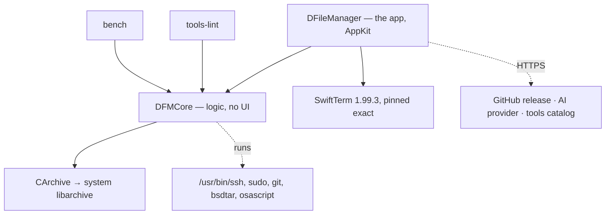
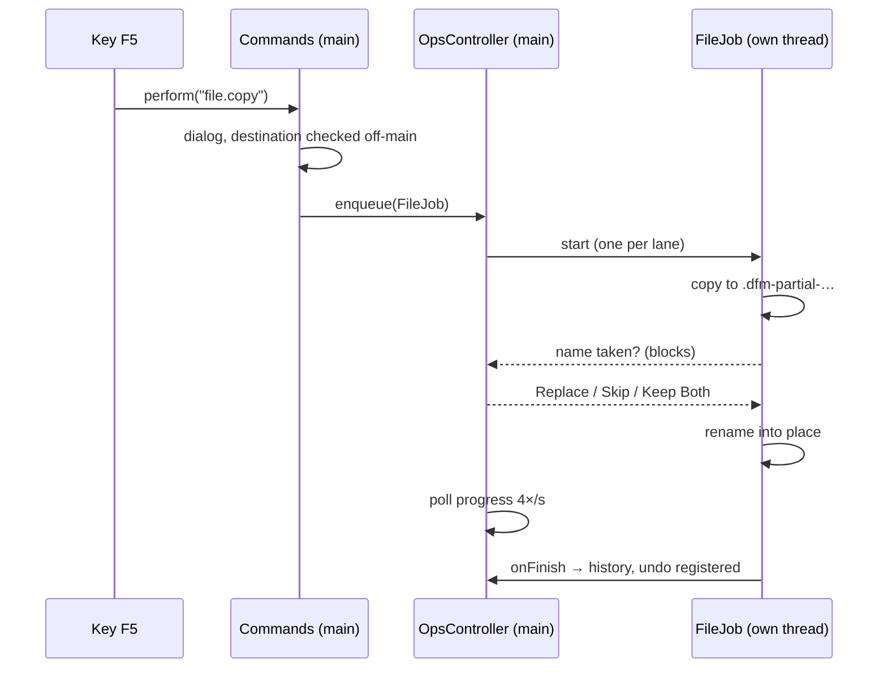
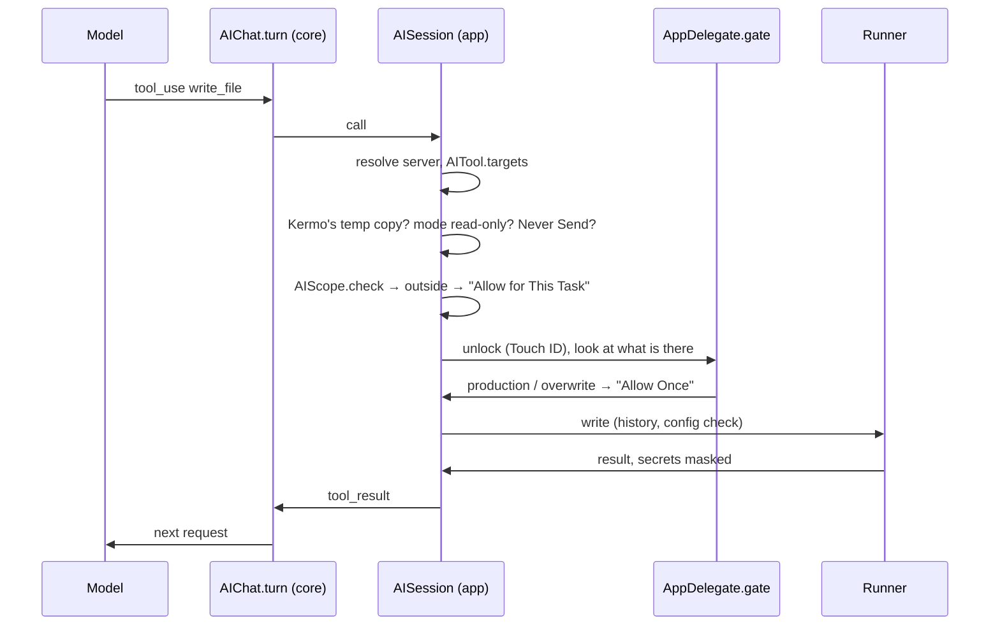

# Kermo architecture

This page is for people who change Kermo's code. It says what the parts are, what each one owns, how they talk to each other, and which rules every change must keep. The user manual is in [docs/](README.md#documentation); how to build and test is in [CONTRIBUTING.md](CONTRIBUTING.md).

File and type names here are the real ones: `grep` finds them.

## The shape in one minute

Kermo is one process, one main window, no helper daemons and no sandbox. It is a SwiftPM package with two code targets that matter:

| Target | What it is | May import |
|---|---|---|
| `DFMCore` | Everything that can be decided or done without a window: file jobs, the SFTP client, sync plans, parsers, the Tools engine, the AI loop and its rules. About 17k lines. | Foundation, Darwin, CryptoKit, Security, DiskArbitration, `CArchive`. **Never AppKit or SwiftUI.** |
| `DFileManager` | The app: AppKit windows, panels, the command registry, sheets, the editor, the terminal. About 43k lines. Ships as `Kermo.app`. | `DFMCore`, AppKit, SwiftTerm, a little SwiftUI and Charts. |

Beside them: `CArchive` (a module map over the system's libarchive), `bench` and `tools-lint` (two small command-line programs over `DFMCore`), and two test targets, one per code target.

The one dependency rule: **`DFMCore` knows nothing about the app.** When core code needs something from the UI (a password, an answer to "replace?"), it takes a closure or a small protocol and the app supplies it. That rule is what lets 740 of the 1,530 tests run with no window.

The second rule: **servers are reached only through the system's `/usr/bin/ssh`.** There is no SSH library. The user's `~/.ssh/config`, agent, keys and known hosts work as they do in Terminal, and Kermo's own SFTP v3 client speaks over the pipes of an `ssh -s sftp` child.

## Design priorities

Every choice is weighed by these, in this order when they clash:

1. **Nothing is lost and nothing is half-written.** A file lands under a temporary name and is renamed into place. An operation that changed since it was planned is skipped, not guessed.
2. **Nothing can be intercepted.** Secrets never travel in argv or the environment. Text from a server is data, never a command.
3. **Speed.** No disk or network call on the main thread. A listing of 100k files in under half a second.
4. **Lightness.** One dependency. No web view. No index of its own.

## Decisions and why

- **AppKit, not SwiftUI, for the panels.** An `NSTableView` scrolls hundreds of thousands of rows without a hitch; SwiftUI is used only for a few forms and the charts.
- **SwiftPM and shell scripts, no Xcode project.** The Command Line Tools are enough to build, test and package.
- **The system's `ssh`, no library.** Whatever works in Terminal works in Kermo: config, agent, jump hosts, hardware keys. The price is a child process per operation, paid down by one shared ControlMaster per server.
- **An SFTP client of its own.** The `sftp` program can't pipeline requests or say what failed; the protocol is small.
- **No sandbox, no privileged helper.** A file manager needs Full Disk Access. Root on this Mac is asked for per action through the system's own administrator prompt, so nothing privileged stays running.
- **No index, no web view, no database.** State is JSON files a person can read and repair.
- **One dependency, pinned exact.** The terminal uses SwiftTerm beyond its documented surface: the child's pid and descriptor, input-state snapshots, OSC observers, the caret frame, mouse mode, and a delegate (`TerminalGate`) that must forward every delegate method by name. Before moving the pin, check each of these in `EmbeddedTerminal.swift` — a delegate method SwiftTerm adds would otherwise get its default silently.

## Threads

The compiler checks most of this: the package builds in Swift 6 language mode with complete strict concurrency.

- **Main actor.** All of `DFileManager` except a few watchers. All state the user sees lives here.
- **`Blocking.run`** (`DFMCore/Blocking.swift`). The one bridge from `async` code on the main actor to a blocking call on a GCD queue. Listing a folder, an ssh round trip, a hash, a stat: all go through it. `Coalesced` on top of it runs only the latest of repeated requests.
- **One thread per `FileJob`**, with a 16 MB stack for deep trees. It asks the user by calling a closure that blocks until the main thread answers (`OpsController.ask`).
- **`SFTPClient`**: one caller at a time, plus a reader thread that matches replies to requests by id. `KeptSession` holds the lock that makes "one caller at a time" true.
- **Serial queues that own a file**: `Config.writes` (every JSON in the config folder, the audit log, chat files), `dfm.drafts` (editor drafts), `dfm.monitor.history` (watching history).
- **Stale answers are dropped by a generation number.** A panel's listing, sort, sizes, git status and preview each carry the number that was current when they started; a result whose number is old is thrown away.

Where the compiler can't prove safety the code says so: about 25 `@unchecked Sendable` types (each guards its state with a lock) and about 70 `nonisolated(unsafe)` variables (mostly test seams set once). A new one needs a comment that says who holds what.

## DFMCore, module by module

Each row is a group of files in `Sources/DFMCore/`.

### Local files

- **`DirLister`, `FileItem`, `FileInfo`** — A folder's listing in one system call (`getattrlistbulk`), the item model, panel sort with precomputed keys, stat/xattr/ACL helpers. `FileInfo.writeWhole` is the atomic write every small state file uses.
- **`FileJob`** — One queued copy, move, trash or delete. Local copies use `copyfile(3)` (clones on APFS, carries xattrs and ACLs). Keeps progress as a snapshot the UI polls; never calls the UI itself.
- **`Transfer`** — The same job when a side is a server. `TransferFS` is the one abstraction over "a place with files": `LocalFS` and `RemoteFS`. Pipelined, resumable through `.dfm-partial-*` names.
- **`DirSync`, `DirCompare`** — Compare two trees into a plan (`[Item]`), turn a reviewed plan into `FileJob`s. Each job carries what Compare saw (`expected`), and skips what changed since.
- **`Archive`** — Reads archives through libarchive as folders; extracts through a staging folder with `bsdtar`.
- **`FileSearch`, `Mask`, `Fuzzy`, `Rename`, `SplitParts`, `Disks`, `FinderTags`** — Search (walk, Spotlight, or `find` on a server), masks, fuzzy match and frecency, batch rename in two phases, split/merge, volumes, Finder tags.

### Servers

- **`SFTP`** — `SFTPTarget` (who to connect to), the ssh argument list, the shared ControlMaster per server in a private 0700 folder, login serialised per server, `KeptSession` (a panel's SFTP session kept between listings).
- **`SFTPClient`** — The SFTP v3 protocol: pipelined reads, writes and listings, and `upload` — the safe save of one file (see the flow below).
- **`Askpass`, `HostKeyChange`** — The password prompt path and the changed-host-key path. A prompt reaches the app over a unix socket that checks the caller is the same user and a child of this app.
- **`SudoServer`, `AdminCommand`** — Root on a server (`sudo` in front of the server's own `sftp-server`) and root on this Mac (one `osascript` administrator command).
- **`ShellCommand`** — The only place that quotes text for a shell and decides whether text may be typed into a terminal.
- **`ConfigCheck`, `ServerHistory`** — Checks before and after saving a server's config file (`nginx -t` and the like, with the old text put back on failure), and the local history of every file saved to a server.
- **`Tunnel`, `MultiRun`, `Services`, `ListeningPorts`, `ServerSizes`, `SSHKeyCopy`** — Port forwards (a listener on loopback, one `ssh -W` per connection), one command on many servers, systemd units and containers, listening ports, `du`, key install. Each is one fixed script with data passed as arguments or stdin.

### Text

`BigFile` and `FollowReader` (mmap and `tail -F` for the viewer), `LineEdit`, `TextDiff` (Myers with a budget), `TextFormat`, `Syntax` (a regex lexer), `ANSI`, `DraftStore` (the editor's crash-safe drafts). All pure except the two that read files.

### Tools (`DFMCore/Tools/`)

A *tool* is a JSON preset that describes a list with actions, a dashboard and what to watch. The engine has no knowledge of any particular tool.

- **`ToolPreset`, `ToolSchema`** — The model and its single field table: validation with line numbers and the published JSON Schema come from the same table.
- **`ToolTemplate`, `ToolPayload`** — `{name}` placeholders and the script sent to a server. **A value never becomes shell text**: `{x}` turns into `"$K_x"` and the value is assigned in a preamble. Secrets travel in a heredoc on stdin.
- **`ToolExec`, `ToolLong`** — One run (timeouts, output caps, sudo retry) and detached long jobs that survive a dropped connection.
- **`ToolRecords`** — Parsers from command output to rows: lines, JSON, TSV/CSV, tables, regex, Prometheus, Nagios.
- **`ToolRules`, `ToolSlots`** — Watching as pure functions: frames → samples → history, alerts, events. A week of 15-minute slots on disk.
- **`ToolLibrary`, `ToolCatalog`, `ToolInstall`** — Where tools come from, which are trusted, the signed catalog.

Trust in one paragraph: built-in tools are trusted. Any other runs **nothing** until the user approves a sheet that lists what it can run; approval is stored as the SHA-256 of the preset and its scripts, so any edit asks again. A catalog index is verified with Ed25519 before it is parsed, each file is taken only with the hash the index names, and an index older than the last one seen is refused.

### AI (`DFMCore/AI/`)

- **`AIProvider`, `AIAnthropic`, `AIOpenAI`** — The provider protocol (a stream of events), two wire formats, the key store (Keychain, one key per address, never sent over plain HTTP to a public host).
- **`AIChat`** — The turn loop: send, take the model's tool calls, run each through a closure the app supplies, send the results. Capped by rounds and by cost.
- **`AITool`, `AIScope`, `AICommand`** — The 14 tools, what each may touch, and the rules: `AIScope.check` answers *allowed*, *ask* or *outside*; `AICommand.isReadOnly` is an allow-list that decides whether a shell line only reads; `AICommand.overwrites` names the commands that ask every time (`rm`, `> file`, `cp`, `sed -i`…, each command by its own program).
- **`AISecrets`, `AIEdit`, `AIContext`** — Masking of secrets before text leaves the Mac, exact-once edits, the snapshot of what the user is looking at.
- **`MCP`** — The same tools for an outside agent: JSON-RPC over a unix socket, owner-only.

## DFileManager, part by part

### The shell of the app

- **`main.swift`** — two helper modes that exit at once (`--askpass`, `--mcp`), else the app.
- **`AppDelegate.swift`** — the composition root. It builds the window, owns the panels, the operation queue, the registries and the saved state, and wires each part to the others with closures. Other files extend it: `extension AppDelegate` is how a feature gets at the app's state (`Commands.swift` and its `Commands+*.swift` are such extensions).
- **`Commands.swift`** — the command registry. **One command id serves every surface**: its menu item, its key, its button on the key bar, its line in the palette (⇧⌘P), its row in Settings › Keys and in F1. All of them call `perform(id)`, which is where "not available here" is decided once. A new action is a new `Command`, never a new menu target. What the commands do lives beside it, one file per area: `Commands+Servers.swift`, `Commands+Archives.swift`, `Commands+Undo.swift` and so on.
- **`Config.swift`** — the config folder (`~/.config/dfilemanager/`). A file that can't be read at all is never saved over until it can be; one that reads but doesn't parse is first copied aside as `.broken`. Saving is serialised, atomic and owner-only. A file that bypasses `Config.loadKeeping` gets neither guarantee — new state files should load through it.
- **`Session.swift`**, **`Settings*.swift`**, **`Shortcut.swift`**, **`Theme.swift`**, **`Updates.swift`** — saved tabs, the Settings window, key parsing, colours, the updater.

### Panels

- **`PanelViewController.swift`** — one panel: its tabs, its listing, sort, marks, cursor, quick filter, Quick View. A tab shows one *place*: a local folder, a server folder, an archive, search results, or a list (below). It talks to the app only through `on…` closures set in `AppDelegate.wire`.
- **`ListPanel.swift`**, **`Picker.swift`** — a panel or a popup that shows rows that aren't files (services, ports, a tool's list) with the same keys and the same table.
- **`Sidebar.swift`**, **`PathBar.swift`**, **`KeyBar.swift`**, **`HeaderSearch.swift`** (the search field, which is also the command palette), **`QuickOpen.swift`**, **`Palette.swift`** (colours, symbols and chips shared by the lists) — the chrome around the panels.
- **`OpsController.swift`**, **`Activity.swift`** — the queue of `FileJob`s: one running job per *lane* (this Mac, or one server), progress polled four times a second, questions shown as sheets, history kept.

### Servers in the UI

`Remote.swift` (saved servers, Keychain passwords, `ServerLock` — Touch ID per server, `Masters` — connections stopped on wake and network change, tunnels' state), `ServerGate.swift` (`AppDelegate.gate`: Touch ID for each locked target through `ServerLock.authorize`, then the caller's production question; `unlock` is the same gate with no question. A few places that only connect — a menu item, a tunnel, Run on Servers — call `ServerLock.authorize` themselves), `Audit.swift` (the log of what was done on production), and the sheets and lists: `ServerSheet`, `ServerServices`, `Tunnels`, `RunOnServers`, `CopyKey`, `AskpassSheet`.

### Editor, viewer, terminal

- **`Editor.swift`**, **`EditorHost.swift`** — a document (one text storage, several views) and its window (tabs, two panes, Compare). Saves are described below.
- **`Viewer.swift`** — F3. Small files load whole; big ones are mapped and shown through a sliding window; whole-file search reads through the descriptor.
- **`EmbeddedTerminal.swift`**, **`TerminalLinks.swift`**, **`ToTerminal.swift`** — SwiftTerm views, one pty each, up to four per tab. `TerminalGate` stands between SwiftTerm and the app: it refuses hyperlink escapes and clipboard reads. Text sent to a shell passes `TerminalText.checked` first: no control characters, and several lines only as one bracketed paste.

### Tools and AI in the UI

- **`Tools/ToolRunner.swift`** is the hub every tool action goes through (trust → form → gate → run → audit). `Tools/Monitor/` is watching: one channel per server, the menu bar item, notifications, charts. `Tools/Window/` is the Tools window and the tool editor.
- **`AISession.swift`** is the single chain every model tool call goes through — the chat's and an outside agent's alike. `AIPanel.swift` is the chat; `AIAgents.swift` admits MCP connections.

## How the parts work together: five flows

### 1. F5: copy a file

Undo trashes only what the job created, matched by inode. Cancel leaves no partial file.

### 2. A server session

A panel asks `SFTP.session(target, on: kept)`. If no ControlMaster for that server answers `-O check`, one is started (`ssh -f -N`), with logins to one server serialised. A password prompt from ssh runs Kermo's askpass script: a saved password comes through a one-shot FIFO; anything else goes over the unix socket to a sheet in the app. The SFTP client then runs as `ssh -s sftp` over the master, and the panel keeps it between listings. On wake or a real network change `Masters.stop` drops the sockets so the next action logs in afresh.

### 3. Saving a file on a server (F4, ⌘S)

1. The editor saves its local temp copy atomically.
2. `RemoteEdit.save` → `SFTPClient.save`: the server's file is compared with what was opened (size and time, then SHA-256). Changed there → the user chooses.
3. The old text is read for the local history.
4. The new text is written whole to `.dfm-partial-…` (created exclusively, owner-only).
5. A "before" check, if a rule matches the path, runs on the partial file.
6. `posix-rename` over the file. Where a rename would break the file (another owner, SELinux, a hard link) it is written in place instead, after the old text is copied aside.
7. An "after" check (`nginx -t`) runs; on failure the old text is put back.
8. `AuditLog.write` records it; the log keeps lines for production servers only.

### 4. A tool's action

`ListAction` → `ToolRunner.perform`: trusted? → `ready`: server unlocked, form filled, values checked, payload built, question asked (always for a dangerous action, always on production) → `ToolExec.run`: one `ssh … sh -s` with the script on stdin → output parsed into rows → audit, result line, list read again.

Watching is the same payload kept open: one channel per server carries every watched tool's lines, each tagged with its tool. `ToolFrames` → sample → `ToolHistory` (charts), `ToolSlots` (disk), `ToolAlerts` (notification, menu bar).

### 5. The assistant changes a file

The model never holds a capability: every call is re-checked against the scope the user granted, and a question the model causes after it has read a server's text is marked ⚠.

## Where state lives

- **Servers, keymap, user menu, bookmarks, validators** — `~/.config/dfilemanager/*.json`
- **Tools: presets, trust, catalog state, watching history** — `~/.config/dfilemanager/tools/`
- **Editor drafts; old text of in-place saves** — `~/.config/dfilemanager/editor.noindex/`, `saves.noindex/`
- **AI chats (last 50)** — `~/.config/dfilemanager/ai/`
- **Production audit log, activity history** — `audit.jsonl`, `activity.json` in the same folder
- **Tabs, window state, small switches** — UserDefaults (`com.dmn.dfilemanager`)
- **Passwords, the AI key** — The login Keychain
- **ssh control sockets, askpass** — A private 0700 folder under `/tmp`, checked for ownership
- **History of files saved to servers** — A local folder per server and path, 20 versions each

Files are owner-only (0600 in 0700 folders). Everything in the config folder is plain JSON a user may edit: a file that doesn't parse is copied aside as `.broken` and said so before anything is written there.

## Trust boundaries

Text that crosses one of these lines is data. The code that handles each line is the place to look when changing anything near it.

- **A file name, on this Mac or a server** — `ShellContext.quote` (one word to any shell, fish too); `isTypeable` before anything is typed into a terminal; `FileJob.isSafeName` for names a server returns.
- **A server's output** — Parsers in `ToolRecords`; never interpolated into a command. In a terminal: `TerminalGate`.
- **A tool from outside** — `ToolTrust` (hash of what was approved), `ToolCatalog` (signature before parsing).
- **The model, and whatever it read** — `AISession.pass` → `AIScope.check` → `AppDelegate.gate`; `AICommand.isReadOnly`; `AISecrets.mask` on the way out. Kermo's temp copies of server files (`TempCopies.within`) are never this Mac's to the model.
- **An update** — `Updates.isSigned`: the new app must satisfy the running app's own code-signing requirement, checked again on the copy that is installed.
- **Another process on this Mac** — Unix sockets check the peer's user and that it descends from this app.

## Invariants

A change that breaks one of these is a bug even if every test passes.

1. A file is written whole under a temporary name, then renamed. Where that's impossible the old content is copied aside first.
2. Nothing follows a symlink it didn't expect.
3. A queued job acts on a path only if it still looks as it did when the user decided, and an action takes its items only from the current listing of the current place.
4. No secret in argv, in the environment, in a log or in an error message.
5. Nothing connects to a locked server before `ServerLock.authorize` says yes, and a change on a production server asks first: both normally through `AppDelegate.gate`.
6. The main thread doesn't wait for a disk or a network. The deliberate exceptions are tiny and local (`Config.flush()` before opening a just-written file); a new one needs a reason in a comment.
7. An untrusted tool runs nothing. A model's call is checked every time.
8. `DFMCore` imports no UI framework.
9. Every built-in action is a `Command` in the registry. (A user's own commands in `usermenu.json` are the exception: F2 reads the file each time and they have no id.)

## Tests

`./test.sh` runs both targets with swift-testing: about 740 tests of `DFMCore` and 790 of the app.

- Core tests use real files in a temp folder, and for servers a throwaway `sshd` on loopback with its own keys (`withTestSSHD`) — the real `ssh`, the real protocol.
- App tests build a real `AppDelegate` and real views in-process, with the config folder moved to a per-process temp folder (`Config.isTestRun`).
- `DocsTests` fails when a default shortcut or a `defaults` key is missing from the docs.
- A defect found and not yet fixed is pinned with `withKnownIssue`, so the fix is noticed. None is pinned now.

## Build and release

`build.sh` runs `swift build` and assembles `Kermo.app` by hand (no Xcode project). `package.sh` builds the universal app, signs it with the release certificate and writes the zip, pkg and dmg. `tools/release-notes.py` checks the pieces and writes `latest.json`, which each running copy reads once a day to learn of a new version. The steps are in the comment at the top of [CHANGELOG.md](CHANGELOG.md).

## Where to start reading

- **What a key or menu item does** — `Commands.swift`: find the id in `makeCommands()`, then the action in `Commands+<area>.swift`
- **How files are copied** — `FileJob.swift`, then `Transfer.swift` for servers
- **Anything that talks to a server** — `SFTP.swift` (connection), `SFTPClient.swift` (files), `ServerGate.swift` (permission)
- **A panel's behaviour** — `PanelViewController.swift`; rows that aren't files: `ListPanel.swift`
- **A tool's format** — `ToolSchema.swift` — the field table; `docs/tools.md` must follow
- **What the assistant may do** — `AIScope.swift`, `AICommand.swift`, then `AISession.pass`
