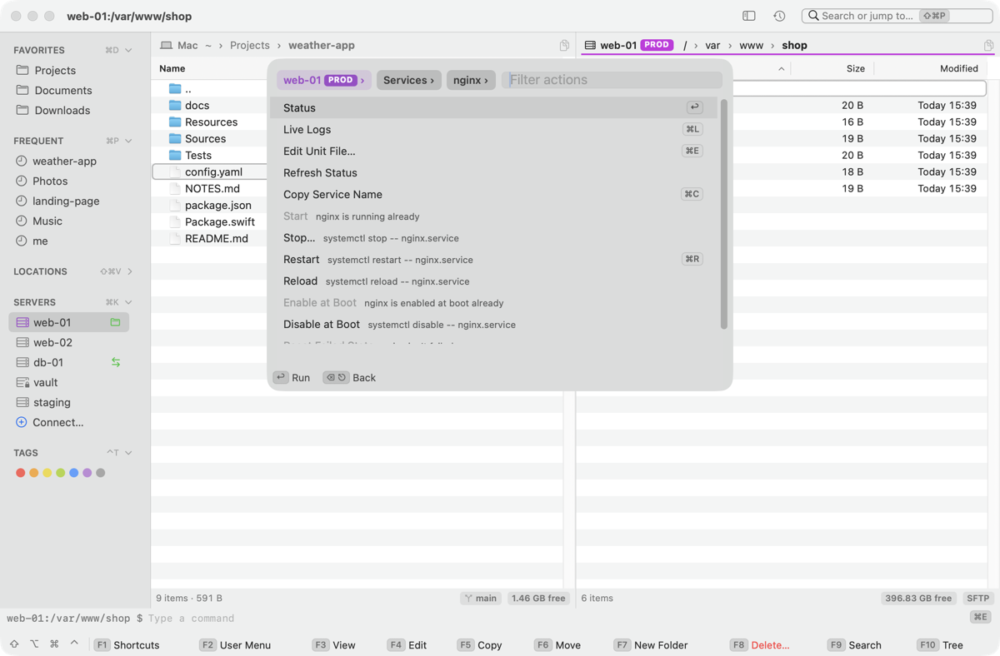

# Kermo

A keyboard-first file manager and admin console for macOS: 2–4 panels, SFTP and SSH, a built-in terminal. Built with Swift and AppKit. *Kermo* is Ukrainian for "helm".

macOS 14 or later · Apple Silicon and Intel · [MIT license](LICENSE)

[](https://youtu.be/8g9k_CSyGTw)




## Install

Paste this into Terminal and press Return. It installs the latest release, or updates Kermo to it:

```sh
curl -fsSL https://raw.githubusercontent.com/paliydmn/kermo/master/install.sh | sh
```

Or by hand:

1. Download the `.dmg` or `.pkg` from the [latest release](https://github.com/paliydmn/kermo/releases/latest).
2. Drag **Kermo** to Applications (the `.pkg` installs it for you) and open it.
3. The first launch is blocked, because Kermo isn't notarized by Apple. On macOS 15 or later click **Open Anyway** in System Settings ▸ Privacy & Security; on macOS 14 Control-click the app and choose **Open**.

Kermo checks for a new version once a day and installs it with **Install and Relaunch** (**Kermo ▸ Check for Updates…**). Updating, uninstalling and building from source: [Install Kermo](docs/install.md), [Contributing](CONTRIBUTING.md). New here? Start with [Getting started](docs/getting-started.md).

## What it does

- **Panels, search and keys.** Two to four panels with tabs, a Places sidebar and a key bar that shows the shortcuts for the modifier you hold. One search (⇧⌘P) finds commands, servers, folders and files, and ⇥ goes into a server: its services, containers, ports and tunnels, and what you can do to each. Every command is in the menu bar too, and every option in Settings (⌘,). → [Panels, sidebar and search](docs/window.md), [Configuration](docs/configuration.md)
- **Files.** Copy and move in a queue with progress, pause and undo, and an Activity list with Retry Failed; marking in Midnight Commander style; archives, batch rename, Finder tags. → [Files and folders](docs/files.md)
- **Find and compare.** Search by name, content or Spotlight; compare and synchronize folders, also with a server; diff files. → [Search, compare and synchronize](docs/search-compare.md)
- **View and edit.** A viewer for multi-gigabyte files with hex and `tail -f`; an editor with syntax highlighting. → [Viewer and editor](docs/viewer-editor.md)
- **Git.** Status column, branch, diff, log, blame, stage; switch branches, commit and sync from the sidebar. → [Git](docs/git.md)
- **Servers.** SFTP panels and SSH sessions through the system OpenSSH. A server opens as a place: its overview of files, services, containers, ports and tunnels. Saved servers with Touch ID locks, your SSH key copied to a server in one step, copy between this Mac and servers. → [Servers and SSH](docs/servers.md), [The server as a place](docs/servers.md#the-server-as-a-place), [Files on a server](docs/server-files.md)
- **Services and containers.** A server's systemd services and its docker or podman containers, failed first, in search or in a panel with columns. Each has its actions: status and Quick View, live logs in the panel next door, start, restart, stop, reload, enable at boot; a container's logs and restart. → [Services and containers](docs/servers.md#services-and-containers)
- **Safe server edits.** Open files as root through the server's own `sudo`, check a config with the server's tool before it is saved, reload the service, and get earlier versions back. → [Server files as root](docs/root-panel.md), [Checks on save](docs/config-checks.md)
- **Tunnels.** Forward a server's database or web admin to `localhost`, or pick from the ports it listens on; its ports and tunnels are lists in a panel too. → [SSH tunnels](docs/tunnels.md)
- **Terminal.** A shell in a drawer under the panels, the active one following its `cd`; SSH tabs, each split into up to four sessions side by side; Claude Code and other programs that use the mouse scroll and copy; a user menu, one command on several servers at once, and the `fm` command. → [Terminal](docs/terminal.md), [Commands](docs/commands.md)
- **Production safety.** A production server is purple, asks before changes and logs what you did. Every question before a change reads the same way: the place in a PROD or ROOT strip, what changes, and the command exactly as it will run. → [Safety on servers](docs/safety.md)

## Keyboard at a glance

| Keys | Action |
|---|---|
| ⇧⌘P | Search commands, servers, folders and files; ⇥ goes into a server |
| ⇧⌘O | A server's overview: services, containers, ports, tunnels |
| ⌘↩ | Open in the other panel: a folder, or a server's list |
| F1 | Cheat sheet with every shortcut |
| Tab, Space | Other panel, mark a file |
| F3 / F4 | View / edit |
| F5 / F6 | Copy / move to the other panel |
| F7 / F8 | New folder / Trash |
| ⌘P | Jump to a bookmarked or frequent folder |
| ⌃⌘K / ⌘K | Server files / SSH shell |
| ⌃O | Terminal |
| ⌘\\ | Split the terminal: a second session beside this one |
| ⌘, | Settings |

Mac function keys control media by default: ⌥ plus the digit does the same (⌥5 is F5). The full list is in [Keyboard shortcuts](docs/shortcuts.md).

## Documentation

**Start**
- [Install Kermo](docs/install.md): release, update, uninstall.
- [Getting started](docs/getting-started.md): five minutes from install to your first server.

**Use Kermo**
- [Panels, sidebar and search](docs/window.md): the window, the key bar, Places, search and going into a server, the menus.
- [Files and folders](docs/files.md): copy, move, delete, undo, rename, archives, tags.
- [Search, compare and synchronize](docs/search-compare.md): filter, find, compare folders, diff.
- [Viewer and editor](docs/viewer-editor.md): large files, hex, follow, syntax highlighting.
- [Git](docs/git.md): status, diff, log, blame, stage, branches, commit, sync.
- [Terminal and SSH sessions](docs/terminal.md): the ⌃O terminal, sessions side by side, shell integration.
- [Commands, user menu and `fm`](docs/commands.md): ⌘E, F2, placeholders, the `fm` launcher.

**Servers and administration**
- [Servers and SSH](docs/servers.md): connect, save, lock, mark as production, copy your SSH key; a server's overview, services and containers.
- [Tools](docs/tools.md): a server's firewall rules and banned addresses as lists with actions; your own tools.
- [Files on a server](docs/server-files.md): copy, edit, preview, compare, file history.
- [Server files as root](docs/root-panel.md): a root panel through `sudo`.
- [Checks on save and reloads](docs/config-checks.md): `visudo`, `nginx -t` and the like before a bad save.
- [SSH tunnels](docs/tunnels.md): forward remote ports to this Mac.
- [Safety on servers](docs/safety.md): production servers, the production log, what stays on your Mac.

**Reference**
- [Keyboard shortcuts](docs/shortcuts.md): every shortcut, grouped.
- [Configuration](docs/configuration.md): Settings (⌘,), files, keymap and `defaults` options.
- [Troubleshooting](docs/troubleshooting.md): symptoms and fixes.

**Project**
- [Changelog](CHANGELOG.md), [Contributing](CONTRIBUTING.md), [MIT license](LICENSE).
- Questions and bugs: [GitHub issues](https://github.com/paliydmn/kermo/issues).
- [Support Kermo](#support-kermo).

## Support Kermo

Kermo is free and open source. If it saves you time, you can support its development:

- [Ko-fi](https://ko-fi.com/kermoinfo)

You can also help without money: star the repository, [report a bug](https://github.com/paliydmn/kermo/issues), or tell a colleague about Kermo.
