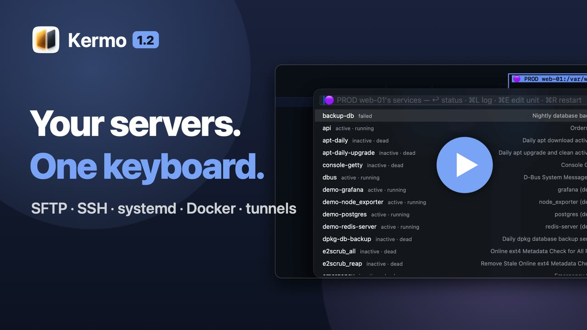

# Kermo

A keyboard-first file manager and admin console for macOS: 2–4 panels, SSH and SFTP, a built-in terminal, built with Swift and AppKit. *Kermo* is Ukrainian for "helm".

## Documentation

- [Requirements and installation](docs/install.md)
- [Window](docs/window.md)
- [Keyboard shortcuts](docs/shortcuts.md)
- [SFTP panel](docs/sftp.md), [as root](docs/root-panel.md), [checks on save](docs/config-checks.md), [production log](docs/production-log.md)
- [SSH tunnels](docs/tunnels.md)
- [Git and the editor](docs/git-editor.md)
- [Command-line launcher](docs/command-line.md)
- [Configuration](docs/configuration.md)
- [Shell integration](docs/shell-integration.md)

## License

Kermo is released under the [MIT License](LICENSE).
