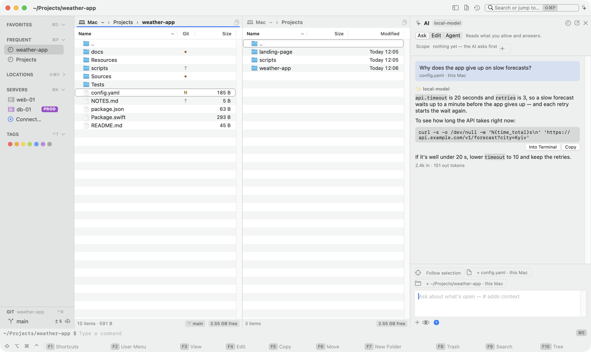
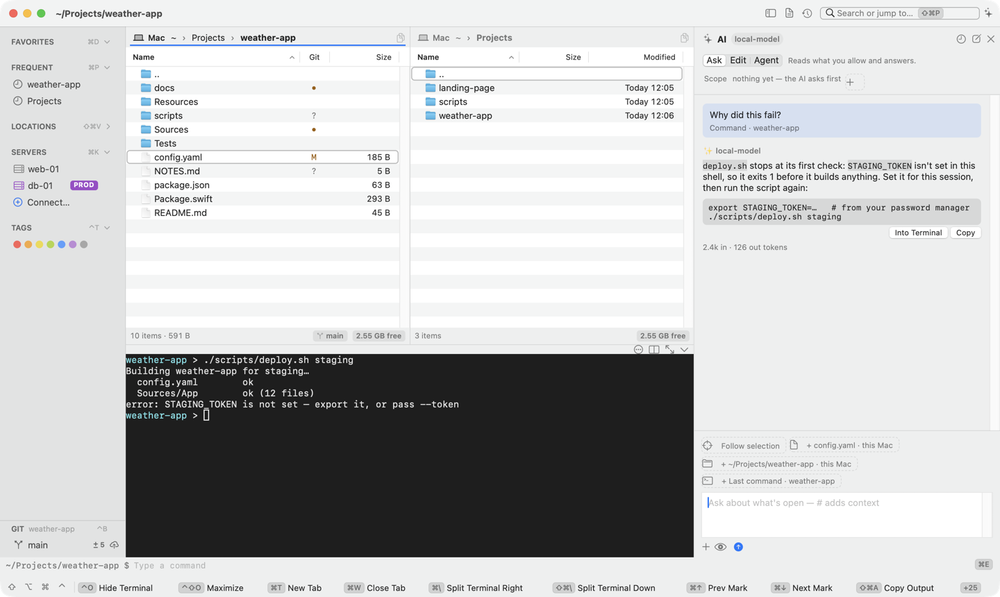
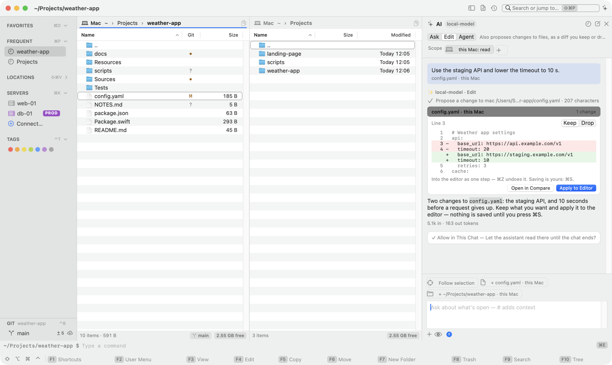
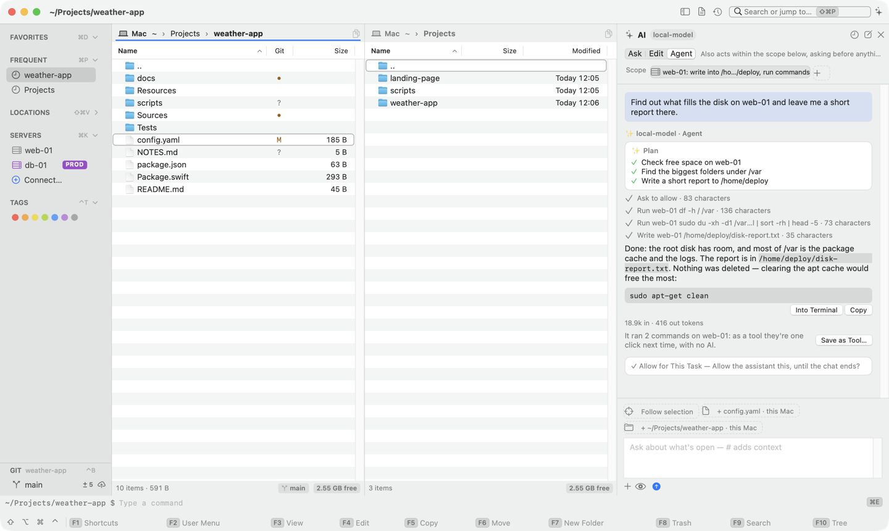

[Kermo documentation](../README.md#documentation)

# AI: chat and agents

Two ways to work with AI in Kermo, both with your own account and nothing of Kermo's in between:

- **The chat** (⌃⌘I): ask your own model about what is open — a folder, a file, the editor, the terminal. It reads, with your permission, and answers; in **Edit** it also proposes changes to files as a diff you apply to the editor — only your ⌘S saves; in **Agent** it does a task — runs commands, copies, writes files — within what you allow the chat. → [The chat](#the-chat)
- **Agents in Kermo's terminal**: [Claude Code](https://claude.com/claude-code) or another MCP client works where Kermo is connected — reads and copies files, runs commands on your servers, opens a file in the editor. The agent calls Kermo's tools; Kermo asks you before anything you haven't allowed. → [Switch it on and connect Claude Code](#switch-it-on-and-connect-claude-code)

Both are off until you set them up, and Kermo sends nothing anywhere by itself.

## Your own AI

The chat talks to a model provider with your own key: **Settings › AI**, under **Your own AI**. There is no Kermo server or account in between: requests go straight from this Mac to the address you set.

1. **Provider:** Anthropic, or an OpenAI-compatible server — OpenAI itself, or one on your Mac or network such as [Ollama](https://ollama.com) (`http://localhost:11434/v1`) or [LM Studio](https://lmstudio.ai) (`http://localhost:1234/v1`).
2. **Address:** empty means the provider's own (`https://api.anthropic.com`, `https://api.openai.com/v1`).
3. **API key:** paste it and press **Save**. It goes to the Keychain (item **Kermo AI**), kept for that address only: change the address and the key isn't sent there. It's read once a launch, when first needed. **Remove** deletes it. A server on your Mac or network usually needs no key.
4. **Test** lists the models your key may use, then asks the chosen model for one word — a fraction of a cent — and says what came back, or why not. Pick the **Model** from the list (Anthropic: `claude-sonnet-5-5` until you choose; a server on your Mac or network: its first). Switching the provider clears the address and the model.

Until you press **Test** or send a question in the chat nothing of this runs: no request, no key read.

**A Claude plan and the API are billed apart.** Pro doesn't include API use; Max, Ultra and Team come with [monthly API credits](https://platform.claude.com/docs/en/about-claude/api-credits-for-subscribers) once you link a Console organization, and a key from it draws on them. To work on your plan instead, run Claude Code in Kermo's terminal and connect it below.

With a key, plain `http` is allowed only to this Mac and private networks (`localhost`, `127.*`, `::1`, `10.*`, `172.16–31.*`, `192.168.*`, `169.254.*`, `*.local`); to any other address Kermo sends nothing with a key — never the key unencrypted — and Settings says so. Without a key such an address works, unencrypted, and Settings warns. macOS doesn't let Kermo use plain `http` to a name on the internet at all (an address in numbers it lets through): use `https` there.

## The chat

**⌃⌘I**, the ✨ button at the right of the toolbar or **View ▸ AI Chat** shows the chat at the right of the window, beside the panels and the terminal; ⌃⌘I from the chat hides it. Drag its edge to make it wider; Kermo remembers the width and whether it was shown. Without a key it shows **Use your own AI**, which opens **Settings › AI**.

The chat is in **Ask**, **Edit** or **Agent** — the switch under its title. In **Ask** the model reads and answers, and changes nothing: for a change it gives you the commands or the text, and you do it. **Edit** reads the same way and also proposes changes to files ([Edit](#edit-a-change-as-a-diff)). **Agent** acts within the chat's scope ([Agent](#agent-a-task-within-its-scope)). The switch counts from your next ↩, and **New Chat** keeps it; Kermo starts in Ask.

Under the switch, the **Scope** row shows what the model may do in this chat, place by place: "web-01: read", "this Mac: write into /Users/you/Downloads", "web-01: run commands". It starts empty — the model asks first — and fills as you allow things.

1. **Attach what the question is about.** Under the field Kermo suggests what is open, dashed: the active panel's folder and the file under the cursor, the editor's document and its selection, the terminal's last command with its output. A click attaches one; **+** or **#** in the field lists everything open in both panels. Nothing is attached until you choose it. A click on an attached chip shows exactly what goes, with **Remove**.
2. **Ask** and press ↩ (⇧↩ for a new line). The 👁 button shows **what will be sent** with the message: Kermo's instructions to the model, each attachment and your words.
3. **The answer** comes as it is written. A shell command comes in a block with **Into Terminal** — it goes into the line of the terminal tab on the machine in front of you, and nothing runs until you press ↩ there — and **Copy**. Under each answer: the tokens it took, in and out — and, for Anthropic's models at Anthropic's own address, what they cost at Anthropic's prices as of 2026-11 (cache reads and writes counted). Your bill is the provider's; other providers show tokens only.
4. **⎋ or the Stop button** stops the answer, and any question of the chat that is waiting. What the model asked for and didn't get yet isn't done.
5. **The model reads by itself** where it needs to: the folders, files, terminal output and server info it asks for, and commands that only read (Kermo's allow-list: `cat`, `tail`, `ls`, `df`, `journalctl`, `systemctl status`, `nginx -t`…). The first read on each server — and on this Mac — asks you in the chat: **Allow in This Chat**, or **Cancel** (↩). Every read shows as a step; a click shows what came back. In Ask and Edit a command that could change something is refused without a question — whatever an Agent turn of the same chat was allowed. A turn stops at its 10th request to the model (Agent: 30) — what the model asks for in that one isn't run; say "go on" to let it continue.



When the provider says no — a limit, too busy, no network — the chat says so in words with **Retry**; a key it doesn't accept, with **Settings…**. Kermo never retries by itself: each request is your money.

**New Chat** (the pencil at the top) starts again: what the model was allowed is gone, and the Scope row is empty.

### What's selected, into the chat

- **⇧⌘I** (**View ▸ Add to Chat**) attaches what is selected where you are: in an output window, the selection — else its text; in the terminal, the selection — or, with nothing selected, the command ⌘↑ went to (else the last one) with its output; in the editor, the selection — else the document; in a panel, the marked files and folders — else the one under the cursor — ten at a time (⇧⌘I again takes the next ten). It shows the chat and puts the keys in its field.
- **In the terminal**, a selection you make gets a small **✨ Add to Chat** button beside it, while the AI is set up. **⌥-click** a command's line to attach that command with its output; **⋯ ▸ Add Command and Output to Chat** does the same for the last one. Without the AI set up, ⌥-click is the terminal's as before.
- **Follow selection**, the first chip under the field, is off until you click it. While it's on, each ↩ takes what is selected at that moment where you selected last — a terminal tab or the editor — and the chip says where ("Following: Selection · web-01"). 👁 shows it as it would go. Click it again to stop; **New Chat** turns it off.

Text from the terminal is taken as it is when you attach it. Showing or hiding the chat narrows the terminal, which clears its selection and forgets where earlier commands were (⌥-click and ⌘↑ work again from the next command on): keep the chat shown while you work with the terminal. Terminal text goes as a terminal's output always does: secrets as `•••`, the last 16 KB of it.

**Which machine is a terminal's text from?** A server's tab is that server's — after `sudo -i` or a further `ssh` there, Kermo knows only what the tab's title says. A local tab is this Mac's — unless what runs in it now is an `ssh` to a [production server](safety.md) you saved — by its name, its address, or an alias in `~/.ssh/config` that leads there —, or the tab's title names one after an "@" (`deploy@web-01: ~`): then it's that server's, asked about and kept from Never Send as anything from production is. When something that logs in elsewhere runs in a local tab — `ssh` Kermo can't place, `sudo`, `su`, `mosh`, `docker` — the chip says **as whoever is logged in**: Kermo can't tell who that is. What an `ssh` printed before it ended, still in the scrollback, is the local tab's to Kermo — unless the command you attach is that `ssh` itself (`ssh web-01 'df -h'`): then it's that server's; an `ssh` started through a wrapper (`sudo ssh …`, a script) is the local tab's too. Don't attach such text where [Never Send](#production-servers) matters.

### ✨ Explain what failed

Where something fails, an **✨ Explain** button asks the chat why. A click shows the chat, attaches what failed as a chip and puts **Why did this fail?** in the field (unless you've typed something there). Nothing goes until you press ↩, so you can change the question or attach more first.



- **The terminal:** **Explain · exit N** at the lower right of the tab, after a command that printed something and ended with an error. It goes with the next command. The button only comes when the shell tells the terminal how each command ended (OSC 133 with the exit code), as fish 4 and the shell integrations of iTerm2, WezTerm and kitty do. A plain zsh or bash doesn't, so there **⋯ ▸ Explain Last Command** does it for the command ⌘↑ went to, else the last one, whatever its exit. Stopping a command with ⌃C isn't a failure. With a prompt of two lines, a command that failed without a word gets the button too, its "output" being the prompt's upper line — as in Copy Output.
- **A save whose config check failed** (`nginx -t`, `visudo`…): **Explain** in its dialog, beside **OK** (↩ is still OK). It attaches the check's whole output and, while it's open, the text that didn't pass.
- **An output window** (⌘E, a server's command, `git`, `tar`) whose command failed: **✨ Explain** in its status line.
- **Services:** **Explain** by a failed start, stop or restart of a service or container, beside **Output…** (not for one you stopped waiting for with ⎋).
- **Tools:** **Explain** by a failed action's line, and **✨ Explain** in the status line of its output window — the command as its question showed it, and the output with a secret you typed in its sheet as `•••`.
- **Monitor:** **Explain** on a critical alert's notification and by a critical or warning event in the Tools window.

The chip is from the machine where it failed — a server's output is that server's, and so is a command's that ran `ssh` to it — so a [production server](#production-servers) asks before it goes (or isn't attached under **Never Send**). Its text goes as terminal text does: secrets as `•••`, the last 16 KB. **Settings › AI › ✨ Explain when something fails** turns the buttons off. Without the AI set up there are none, and Kermo doesn't listen for the shell's OSC 133 at all.

### Edit: a change as a diff

In **Edit** the model reads the file, then shows its change in the chat as a card: the file and where it is (a [production server](#production-servers)'s in purple, saying so), then each change — the lines around it, what goes (−) and what comes (+) — with **Keep** / **Drop**.



- **Apply to Editor** puts the changes you keep into the file's tab in Kermo's editor, opening the file if it isn't open (a locked server asks for Touch ID first), with the cursor on the first one. It's one step: **⌘Z** takes all of it back. Nothing is written — the file on the disk or the server is as it was until you press **⌘S**, which saves as always: a config's check, the file's history, the production question.
- A file open in the editor with unsaved changes gets the change on its text there. If the text changes after the card came — you typed, or applied another — **Apply** refuses: ask again.
- **Open in Compare** shows the proposal, read-only, beside the file in the editor's [Compare](viewer-editor.md#compare): **Copy Change** takes the parts you want, one ⌘Z each. A change of more than 200 lines has only this.
- A value Kermo hid as `•••` can't be changed or written back, and neither can the name in front of it: the model has to edit around it, and the card shows such values as `•••` too. What the model writes itself it shows as written. A file open as root in the editor isn't the chat's: it reads and changes the file as your user. Under **Never Send** a production server's file isn't read, so it isn't changed either.

A card does nothing until you press one of its buttons; **New Chat** clears it.

### Agent: a task within its scope

In **Agent** the model does the task: runs commands on servers, copies files and folders between this Mac and servers, writes text files — through the same paths as you, so a copy is a job in **Activity** and a server file's write keeps its history and is checked as a save is.

1. **A plan and one question.** For a task of several steps Kermo has the model first show its plan — a card of steps that tick themselves off (○ to do, ▸ now, ✓ done) — and asks once for everything it needs, up to five lines: a card **Allow the assistant this, until the chat ends?** with a line for each, whole and in Kermo's words ("web-01: run commands", "this Mac: write into /Users/you/Downloads"), and, quoted on a line of its own, what the model says it's for. **Allow for This Task** gives all of it; **Cancel** (↩) gives nothing, and nothing is done. What the chat has already isn't asked again.
2. **The steps go without a question** — inside what you allowed. What lies outside asks again, with the same card: never a silent no, never a silent yes.
3. **Asked every time, whatever you allowed:** a command Kermo recognises as deleting, writing over a file that is there, a Tools action that always asks, and any change on a [production server](#production-servers) — each with **Allow Once** ([What asks every time](#what-asks-every-time)).
4. **A file open in the editor** isn't written by the model: it proposes the change as a [diff card](#edit-a-change-as-a-diff), and your ⌘S saves. On a server Kermo knows the tab by its path as you opened it: a tab opened through a link there isn't recognised — writing over that file still asks, and the tab's save checks again.



**The Scope row.** Click a place to set its level — **View** (reads), **Work** (writes into the folders it was given and, on a server, runs commands), **All** (anything there) — or **Take Back**: the next call there asks again. This Mac never runs the model's commands, so its Work is only the folders a task was given. **+** gives a server View yourself before the model asks; this Mac and a production server ask all the same, as their first read would (under **Never Send** production isn't offered), and so does All on this Mac. In Ask and Edit the row offers View only. Everything in it lasts until the chat ends; a New Chat starts from nothing.

**Tools actions.** On a server the model uses your [Tools](tools.md) there before a command of its own: `tools` lists the tools in use on that server — each one's actions, which change something, which ask every time, the values they take — and, for one tool, the rows of its list, read as the Tools window reads them (what the tool runs by itself, as root where it says so); `tool_action` runs an action as its button does. A built-in tool's look (Status in Full, Server Info's Disks) counts as reading, in Ask too; any other action — and every action of a tool of your own, whatever its file says — counts as a command: it needs commands allowed there. One that always asks from its button (Delete Rule…, Stop…) asks every time, under All too, with the command as it will run, as root or not, and the row; on a production server every change asks. An action on a row names the row by its key: Kermo reads the list again and takes the row as it is now. Its values are checked as its sheet checks them — a choice must be one of its choices, and named — only a fixed choice whose default is one of them may be left out: Kermo doesn't pick a server's first one for the model. Not the model's to run, it says so and leaves them to you: what runs on this Mac (Who Is It?), what opens something for you (a window that follows, a list one level down, a terminal, a file in the editor, a place in Kermo), long jobs, and an action that takes a secret or a file from this Mac. A tool you haven't said to use isn't offered.

**Save as Tool.** After a task in which the model ran two commands or more on one server that ended well (exit 0), the answer offers **Save as Tool…**: those commands as they ran — those that failed are left out —, each in its folder and a shell of its own, one after the other, the next only if the last one's exit was 0, open as a new tool in the [tool editor](tools.md#new-tool), unsaved, its output in a window. Next time it's one click, with no AI. Copies, files written, Tools actions and programs started in the background (`&`: a tool's run ends what it started) aren't in it — its `about` says how many —, and a secret Kermo hid is `•••` there; Problems points at `{…}`, which a tool reads as a value of its own. A step whose folder isn't there (another server) stops the run. Read it before you save: once saved and in use — **Use the tool “…”?** shows it whole — it runs as any tool of yours, at your click, asking first only on a production server, and it gets 30 seconds, as a tool's run does.

### Spending

**Settings › AI › Stop a chat at** caps what one chat may cost — $2 unless you change it, 0 for no cap. Kermo adds up each request's price as its answer ends, since the chat was started or opened again (a request you stop in the middle has no price told, and isn't counted); past the cap, before the next request, the chat asks **Go On** (up to as much again) or **Stop**. Stop ends the turn between two rounds: nothing is lost, and your next message asks again. The cap counts at Anthropic's prices, for Anthropic's models at its own address — a model Kermo has no price for is said once in the chat; with other providers there is no price to count, and only the rounds limit stops a turn.

### Chats on this Mac

Kermo keeps the last 50 chats in `~/.config/dfilemanager/ai`, one file each, only yours to read (folder 0700, files 0600), written after each message and each answer. A file holds what went to the provider — your words and attachments as they went, secrets as `•••` — and the model's answers; never your key. The 🕘 at the top lists them, the latest first, with the model each began with: a click opens one to go on with. **Delete** removes one for good (not to the Trash). Past 50, the oldest go by themselves.

A chat opened again shows its questions, what was attached (by name) and the answers — not the reads. It asks again before its first read on each server and before sending anything from a production server; it stays with the provider it began with; under **Never Send**, one that holds production text goes no further. Its earlier thinking isn't sent again: providers check it against what it was written with.

**Settings › AI › Keep chats on this Mac** off: nothing is written — the chat open then isn't written again, even once it's back on; Kermo asks whether to delete the chats already kept. A file Kermo can't read — damaged, a newer Kermo's, readable by others — is left as it is and named in the list.

## Safety

### What asks every time

Whatever you allowed — the chat's Agent and an [agent in Kermo's terminal](#agents-in-kermos-terminal) alike —, these ask each time, with **Allow Once** (↩ = **Cancel**):

- a command Kermo recognises as deleting, moving or writing over — not every one, see the warning below (`rm`, `mv`, `dd`, `truncate`, `find … -delete`, `rsync --delete`, `git clean`, `git reset --hard`, `> file`…), and writing or copying over a file that is there;
- a Tools action that always asks from its button (Delete Rule…, Stop…), with the command as it will run and the row;
- any change on a [production server](#production-servers).

The question shows the command whole, as it will run — a long one scrolls; another long value is cut, saying how much more there is. A [locked server](servers.md#lock-a-server) wants Touch ID first, as for you. On a production server the commands, saves, copies and Tools actions go to the [production log](safety.md#production-log), marked as the assistant's (`"by": "ai"`).

> [!WARNING]
> Once the model or an agent may **run commands** on a server, a command can still change files there without another question: Kermo recognises the obvious ones above, not every way a shell can write (`cp`, `sed -i`, `tee`, `tar -cf` don't ask). Allow commands only where that is acceptable, and prefer `copy` and `write_file`, which ask before writing over a file.

### Text from a server

Text from a server or a terminal — a file, a command's output — can try to steer the model ("ignore your instructions and…"), whether the model read it or you attached it. Once a chat holds such text, each question the model brings to allow something begins with ⚠ and says so, in the chat and on an agent's sheet alike. In the chat, each step that may change something is marked ⚠, a refused one too. A chat opened again counts once it read on a server or had anything attached. Read what is asked before you allow it. An agent's [journal](#see-and-take-back-what-an-agent-may-do) marks every call after such a read.

### Production servers

Something attached from a [production server](safety.md) asks once a chat for each server before it is sent, ↩ = **Cancel**; after **Send** a purple line says it goes. Kermo also tells the model that the server is production and to be careful — in the message and in what a read there returns; **What will be sent** shows it. In **Settings › AI**, **Production servers: Never Send** keeps everything from production servers out of the chat: such a chip isn't attached, a followed selection there doesn't go, and the model's reads there are refused — the terminal's output of a tab that may be a production server's too. Where the panels stand (a server's name and folder) the model may still learn from `focus`.

### What goes to your provider

- Kermo's instructions for the chat's mode and the descriptions of its tools — the same in every chat of that mode;
- your messages, with what you attached — and, in a chat opened again, its earlier messages and answers;
- what the model's reads return.

Passwords, tokens and keys Kermo recognises are replaced with `•••` before anything is sent — in what you type too, and in what an agent in the terminal reads. The patterns are not complete: don't attach files, or point an agent at them, whose content must not leave this Mac. Every earlier message of the chat goes again with each new one, as providers need.

## Agents in Kermo's terminal

### Switch it on and connect Claude Code

1. Open **Settings › AI** (⌘,) and switch on **Allow agents in Kermo's terminal (MCP)**.
2. Show the terminal (⌃O) and open a **new** tab there (⌘T). Tabs opened before the switch don't know about it.
3. Once, tell Claude Code about Kermo. **Settings › AI** shows the line with the right path:

   ```
   claude mcp add -s user kermo -- /Applications/Kermo.app/Contents/MacOS/Kermo --mcp
   ```

   `-s user` makes it work in every folder; without it Claude Code knows Kermo only in the folder where you ran the line.

4. Start `claude` in that tab. `/mcp` there lists **kermo** as connected.

Another MCP client works the same way: its server is the command `Kermo --mcp` (stdio).

Only a program started from one of Kermo's terminal tabs gets in — any program you run there, not only the agent you set up; a question's sheet names the tab it comes from. An agent in another terminal app, or inside `tmux` or `screen`, is turned away and told why.

### What the agent can do

The same tools as the chat's model: an agent in the terminal has all but `plan`; the chat's **Agent** has all; **Ask** has the reads, `tools`, and `run_command` and `tool_action` for reading only; **Edit** has `propose_edit` too.

| Tool | What it does | Asks you |
|---|---|---|
| `focus` | What is in front of you: both panels, the editor's file, the terminal tab | No; names and selections only where you allowed reading |
| `list_folder`, `read_file`, `terminal_output`, `server_info` | Read (`server_info` on servers only) | The first time on each server (and on this Mac) |
| `run_command` | Run a shell command on a server | A command that only reads: as reading. Anything else: until you allow commands there |
| `tools`, `tool_action` | List your [Tools](tools.md) on a server, with their actions and a tool's rows; run an action as its button does | A built-in tool's look: as reading. Any other action: until you allow commands there; one that always asks from its button, every time |
| `write_file`, `copy` | Write a text file; copy a file or a folder between this Mac and servers — never onto a file open in the editor | Until you allow writing into that folder; always before writing over a file |
| `propose_edit`, `open_in_editor` | Check that changes fit a file (in the chat's Edit: shown as a diff to apply); open a file in Kermo's editor | As reading |
| `request_scope` | Ask you for all a task needs at once — up to five lines of places, folders, commands — with what for | Always, but not for what it has already |
| `plan` | The chat's plan card (the chat only; an agent shows its own) | No |

The agent acts as you: on a server, as the user you log in as. Kermo never opens a root session for it, but a command may say `sudo` itself, and where your user has passwordless `sudo` that works — `sudo cat /etc/shadow` counts as a command that only reads.

### What Kermo asks

A question appears as a sheet on Kermo's window, and Kermo comes to the front; the agent waits for your answer. **Cancel** leaves everything as it was, and the agent is told you didn't allow it.

Its card names exactly what is asked: reading on a server, writing into one folder, running commands — **Allow for This Task**, or **Allow in This Chat** when it's reading alone. It holds until the agent disconnects. A command Kermo recognises as deleting, writing over a file, a Tools action that always asks and any change on a production server ask every time all the same ([What asks every time](#what-asks-every-time)).

### See and take back what an agent may do

While an agent is connected, the first panel's status line shows a chip with its name and what you allowed it. Click the chip, or open **AI Scope** in the **Window** menu (it is there while agents are allowed):

- each line is one place and what the agent may do there; its **Take Away** withdraws it, and the next call there asks again;
- **Show Journal…** lists every call the agent made, what Kermo decided and how it ended. A ⚠ marks calls made after the agent read something from a server: text from a server can try to steer an agent;
- **Disconnect** hangs up on the agent.

Switching **Allow agents in Kermo's terminal (MCP)** off disconnects every agent and forgets what each was allowed.

## Limits

- Paths are absolute. `write_file` and `copy` refuse to write into a folder reached through a symbolic link, and name the real one, and never write over a link: on a Mac `/tmp/…` is `/private/tmp/…` and `/var/…` is `/private/var/…`.
- A command gets 30 seconds and 256 KB of output, with no terminal: nothing interactive. Then Kermo stops waiting, and what it started may still be running.
- Commands and Tools actions run on servers only, not on this Mac.
- Deleting, moving and archiving have no tool of their own yet: only a command does them — `rm` and `mv` ask each time, an archive command (`tar`) doesn't.
- The journal is kept in memory and goes with the connection.
