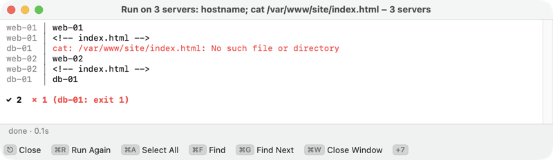

[Kermo documentation](../README.md#documentation)

# Commands, user menu and `fm`

Run a shell command on the files in front of you, keep your own commands in a menu, and open Kermo from the shell.

## Command line

**⌘E** (or a click on **⌘E** at the end of the line) opens the command line for the active panel's folder. At rest it's one line: the prompt (`~/Projects/site $`; on a server its name and folder, `web-01:/var/www $`) and **Type a command**. ↑↓ browse its history (kept per server and for this Mac). While it has the focus the [key bar](window.md#key-bar) shows its keys, and ⎋ goes back to the panel. On a [root panel](root-panel.md) the bar adds **Runs as deploy, not root**: the command runs as the server's user. ⌃↩ and ⌃⇧↩, which insert the name under the cursor and the marked paths, work from the panel: in a text field macOS takes ⌃↩ for its context menu.

| Panel | ↩ | ⇧↩ | ⌘↩ |
|---|---|---|---|
| This Mac | Types the command into the ⌃O terminal's shell | Runs it in an output window (no TTY, any file name) | Runs it in Terminal.app, or the app in `terminalBundleID` |
| A server | Runs it over ssh in an output window | The same | Opens an SSH tab with the command |

An output window's title is the command, with the folder (or server and folder) under it; its status line says `running…`, then the exit status and time, and its key bar says what ⎋ does now: **⎋ Stop**, then **⎋ Close**. In an output window ⎋ stops the command and keeps what it printed; ⎋ again, or once it's over, closes the window. Closing it or quitting Kermo stops the command too. Terminal colors in the output show as colors; errors stay red.

On this Mac, ↩ works as Midnight Commander's subshell does: your aliases and functions, colors, `sudo` and `git commit` prompts, Tab completion and ⌃R all work, and the command lands in the shell's history. On a root panel the command still runs as the user ([root panel](root-panel.md#what-runs-as-root)).

## Run on several servers

**Run on Servers…** (⇧⌘P, the **Admin** menu, or the sidebar's **Servers** header menu) runs one command on several servers at once, the way the command line runs one on a server panel: in each server's login shell, over its ssh connection, without a terminal. So use `sudo -n`, which works where sudo needs no password and otherwise says "a password is required"; plain `sudo` that wants a password stops with "a terminal is required". You see what sudo said. No placeholders: `%f` and `%d` mean nothing across servers.

1. Type the command. The sheet lists your saved servers and the hosts in `~/.ssh/config`, as the Connect picker does; production and locked ones carry their PROD and LOCKED chips.
2. Tick the servers. The filter narrows the list by name or address; in the filter ⌘A ticks all it shows, ⇧⌘A unticks them — the key bar along the sheet's bottom shows those two while the filter has the focus, with ↩ Run and ⎋ Cancel. What runs is what's ticked and shown.
3. Click **Run on 5 Servers** (↩). The last choice and command come back next time.

Up to 8 servers run at once. Logins go one at a time, so password questions come one after another, each saying it's "For “Run on Servers”". One output window shows the lines as they come, each under its server's name, errors in red:

```
web1 │ 14:02:11 up 31 days,  2 users,  load average: 0.08, 0.03, 0.01
db2  │ sudo: a password is required
```



At the end a summary names what didn't go well: `✓ 5  ✗ 1 (db2: exit 1)  1 locked, skipped (vault)`. ⎋ stops them all and keeps the window for the summary; ⎋ again closes it. Once it's over, **⌘R** runs the same command on the same servers again, without the sheet: production servers ask again, a locked one asks for Touch ID if its 5 minutes are up, and the new window takes the old one's place. Stopping ends the ssh connections; without a terminal, a command on the server that writes nothing (a `sleep`) may run on to its end there.

On [production servers](safety.md#production-servers) a command that removes, moves or stops things asks once, naming them all, with ↩ on **Cancel**; each run is a line in the production log. A [locked server](servers.md#lock-a-server) asks for Touch ID before anything runs; refuse, and only that one is skipped.

## Placeholders

In the command line and in the user menu:

| Placeholder | Is |
|---|---|
| `%f` / `%F` | Name / full path under the cursor |
| `%s` / `%S` | The marked items' names / full paths, or the item under the cursor |
| `%d` | The current folder |
| `%D` | The folder in the other panel |
| `%%` | A literal `%` (for example `find -printf '%%f'`) |

Every substituted value is escaped for the shell. A command with `%D` doesn't run when the other panel is on another machine (a local panel next to a server panel, or two different servers).

## User menu

**F2** (⌥2) opens your menu of commands for the files under the cursor. An entry runs as the command line does (table above): ↩, ⇧↩ and ⌘↩ choose where. **Edit User Menu…**, the menu's last row (also in the **Kermo** menu), opens `usermenu.json`, writing fourteen examples on first use (ten for this Mac, four for servers):

```json
[
  { "title": "Restart service", "command": "sudo systemctl restart %f && systemctl status --no-pager %f", "terminal": true, "server": true }
]
```

| Key | Meaning |
|---|---|
| `title` | The menu entry. |
| `command` | The shell command, with placeholders. |
| `terminal` | `true` runs it in Terminal (or the app in `terminalBundleID`); on a server panel it opens an SSH tab with the command. |
| `server` | `true` shows the entry only on a server panel, `false` only on this Mac. Without it the entry shows in both, except that on a server panel it is left out when it calls a Mac-only tool (`xattr`, `open`, `pbcopy` …). |

The four server entries (service status, restart, failed services, and the log of the unit under the cursor) are in the file Kermo writes. If your `usermenu.json` is older and lacks them, Kermo adds them after your entries on a server panel, marked "built in". On a production server, `systemctl stop` and `restart` ask first (see [safety](safety.md) for all that asks).

## The `fm` command

Choose **Kermo ▸ Install “fm” Command** to create a link in `/usr/local/bin`. Then:

| Type | Result |
|---|---|
| `fm` | Opens the current directory |
| `fm ~/a ~/b` | Opens both directories in two panels |
| `fm /etc/hosts` | Reveals the file in its directory |

Kermo also appears in Finder's **Open With** menu for folders.
