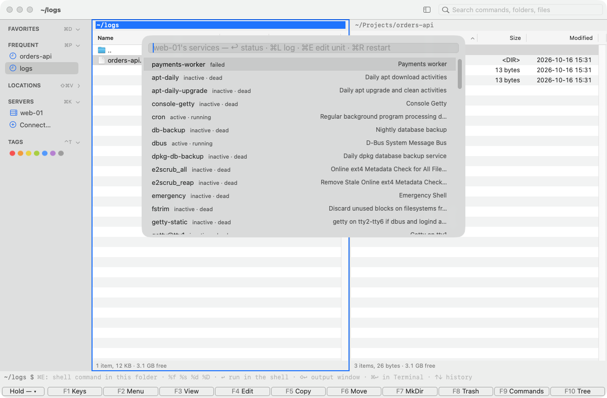
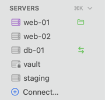

[Kermo documentation](../README.md#documentation)

# Servers and SSH

Connect to a server, save it, lock it and mark it as production. Kermo uses the system OpenSSH client, so keys, agents and `ProxyJump` from `~/.ssh/config` work exactly as in Terminal. Passwords, key passphrases and "continue connecting?" for a server seen the first time are asked in a sheet on Kermo's window: the server's name and its PROD strip, what the answer is for, the field, **Cancel** and **Continue**. Several logins at once ask one after another. If Kermo doesn't take the question within 5 seconds (it's busy), a macOS dialog asks instead, so a login never hangs; the answer goes to ssh and isn't kept anywhere.

## Connect

- **⌃⌘K** opens a server's files in the active panel (SFTP). **⌘K** opens a shell on a server in the terminal (SSH); inside the terminal, ⌘K clears it.
- Both open a picker. Type `user@host:/path`, `user@host:2222/path` or `sftp://host:2222/path`, or choose a saved server (its LOCKED and PROD chips say which; ⌘E edits it), a recent one or a host from `~/.ssh/config`. ⌃⌘K also takes `smb://`, `nfs://` and `afp://` addresses and mounts them.
- A panel keeps one connection to its server while it shows it, so opening a folder doesn't start ssh again. After sleep or a network change the next folder connects again.
- If an SSH tab's session ends, **Server ▸ Reconnect SSH Session** (or the tab's **Reconnect** button, ↩) starts it again. **Server ▸ Disconnect** ends the server's shared connection: its SSH sessions end, its file tabs go back, its tunnels turn off, and a remembered sudo password is forgotten. It asks first while an SSH session is running or a tunnel is listening.

## Save a server

A saved server gets a name, a sidebar row, a Touch ID lock if you want one, a production mark and tunnels.

1. Choose **Server ▸ New Server…** (also in search, in the Servers header's right-click menu, and as **＋ New Server…** in the picker).
2. Fill in the sheet and click **Save** (↩) or **Save & Connect** (⌘↩).

To keep a server you already used, right-click its recent or `~/.ssh/config` row in the sidebar and choose **Save…**.

The sheet has four groups — **Connection**, **Sign in**, **Safety**, **Open** — and, under them, the ssh command it makes as you type (`ssh -p 2222 -i … -- deploy@web-01`; the password never shows there). What ssh couldn't take (a port out of range, a key file it can't read) is said under its field, and Save waits until it's fixed.

| Field | Left empty means | Notes |
|---|---|---|
| **Host** | required | An address or a `~/.ssh/config` host. |
| **User · Port** | ssh's default, 22 | Port 1–65535. |
| **Name** | the address | Shown in the sidebar. |
| **Key** | ssh's own choice (agent, `~/.ssh/config`) | **Choose…** opens `~/.ssh`, in a sheet over this one. |
| **Password** | ask every time | Saved in the login Keychain as "Kermo: user@host" (with `:port` for a port other than 22), one per user, host and port. Shown as dots; the eye beside it shows it after Touch ID or the Mac password. Type to replace it. Read only when ssh asks for a password: a server that takes your key never reads it. |
| **Production** | off | A switch; see [below](#mark-a-server-as-production). |
| **Lock** | not locked | Touch ID or the Mac password; see below. |
| **Start folder** | the login folder | Where SFTP opens. |

Saved servers live in `~/.config/dfilemanager/servers.json` (see [Configuration](configuration.md#saved-servers)). Passwords are never written there.

## Manage a server

Right-click a server row in the sidebar (or click **⋯** under the mouse):

- **Edit…** opens the same sheet, titled Edit Server. **Duplicate…** makes a copy named "name copy"; its tunnels are copied but turned off.
- **Delete…** removes the server and its saved passwords from the Keychain (unless another saved server has the same address). It offers to delete its [file history](server-files.md#file-history) too. Open sessions stay open and its tunnels turn off.
- **Pin** keeps the server at the top of the Servers list. **Remove from Recents** drops a recent address.
- **Open SSH Session**, **Open SFTP**, **Open SFTP in New Tab / in Other Panel**, **Open SFTP as Root** ([root panel](root-panel.md)), **Forward Port…** and **Tunnels** ([tunnels](tunnels.md); both on any server row), **Services…** and **Containers…** ([below](#services-and-containers)), **Copy SSH Command**, **Copy SSH Key to Server…** ([below](#copy-your-ssh-key-to-a-server)) and **Close All Sessions** (the connection closes too, unless a tunnel is on; **Disconnect** also turns tunnels off).
- **Mark as Production** / **Unmark Production**: see below.

**Server ▸ Edit SSH Config…** opens `~/.ssh/config` in the editor and creates it with an example if it doesn't exist.

To run one command on several servers at once, choose **Run on Servers…** in the Servers header's right-click menu: see [Run on several servers](commands.md#run-on-several-servers).

## Services and containers

**Services…** and **Containers…** (⌘⇧P, a server's sidebar menu) list what a server runs, in the same search window as Forward Port…: on the server of the active panel or SSH tab, otherwise you pick one. A locked server asks for Touch ID first; ⎋ stops the look. ⌘↩ shows the list [in a panel](#in-a-panel) instead.

**Services…** asks the server's `systemctl` (systemd's JSON where it has it, its table on an old one), and in the same command whether each service can reload and whether it starts at boot. A row is the service's name, its state (`active · running`, `failed`) and its description; failed ones come first, then by name, and typing searches all three. Services systemd only knows by name (`not-found`) are left out.



| Key | Does |
|---|---|
| ↩ | `systemctl status` in an output window |
| ⌘L | its log as it goes (`journalctl -u … -n 200 -f`) in an output window; ⎋ stops it, ⎋ again closes |
| ⌘E | its unit file in the editor, with what any server file gets there: history, and for `/etc/systemd/system` a check and `daemon-reload` after saving |
| ⌘R | restart it, as root; the list stays open |
| ⌘C | copy its whole name (`nginx.service`) |
| ⌃↩ (⇧F10, a PC keyboard's Menu key), right-click | its menu, below |

The menu has:

- **Status**, **Live Logs**, **Edit Unit File…**, **Refresh Status** (reads its state again, runs nothing), **Copy Service Name**;
- **Start**, **Stop…**, **Restart**, **Reload**: Reload only for a service that has an `ExecReload`, never a restart in its place;
- **Enable at Boot**, **Disable at Boot**: only whether it starts at boot (no `--now`), greyed out for a service that's already so, or static, masked or generated;
- **Reset Failed State**: clears the failed mark (`systemctl reset-failed`), for a failed service only. It doesn't start or fix anything.

Along the bottom, the list's action bar shows these keys — **↩ Status**, **⌘L Live Logs**, **⌘R Restart**, **⌃↩ Actions**, **⎋ Close**, and ⌘E and ⌘C under **+2** where there's no room — and a click on one does what the key does. Before the field, **web-01 ›** says whose services they are, in purple with PROD on a production server; above the rows, how many units there are and how many failed. A failed service has a red ◆ and its state in red; highlighted, the row is the system's blue, as in every list. A right-click highlights the row it's on first, and the menu acts on that service; a right-click on an empty spot opens no menu. The menu runs the same actions as the keys and shows ⌘L, ⌘E and ⌘R next to its items. What can't run now or doesn't apply is greyed out, and its tooltip says why.

Every change keeps the list open, with what you typed, the highlighted service and the scroll as they were. Touch ID for a locked server, the questions and the sudo password appear over the list. **Stop…** always asks first and says what it means (the service stays stopped until started again, or until the server starts if it's enabled at boot; services that need it may stop too); on a production server every change asks. Once it's asked, the row says `Restarting…` (or `Stopping…` and so on) with a spinner, and the service's other changes are greyed out until that ends. Status and log still work. Once the command ends, Kermo reads the service's state again (a second later after a start, stop, restart or reload, so a service that dies at once shows as failed), updates the row, and a line under the list says how it went: which service, on which server, and when.

```text
✓ nginx restarted on web-01 at 22:34:08 — active · running
⚠ nginx: the restart completed on web-01 at 22:34:08, but the service is failed
✕ nginx: the restart failed on web-01 at 22:34:08: Job for nginx.service failed because …   Output…
nginx: not restarted — cancelled; nothing ran
```

Exit 0 is the command's result, not proof that the service works. Each change is judged by what it's for: after a start, restart or reload, a service that is failed, inactive or restarting again a second later gets a warning, not a ✓. After a stop it should be inactive. After enabling or disabling at boot, its unit file should say so (a static unit has no `[Install]` section, so enabling it changes nothing). After a reset it should no longer be failed. An `inactive` oneshot whose run went well counts as done. When the command ran but its state couldn't be read, the line says both. A failed command's line shows its first line, and **Output…** shows all of it. **Refresh Status** writes the service's state in that line too (`↻`). The line stays until the next action, or until the list closes; moving around and typing leave it. Closing the list doesn't stop or undo a command that's running: its result shows in the status line, a failure as an alert, and Services… then reads fresh states. Services… opens again with what you typed and highlighted last on that server, for example after a look at a status or a log.

Status and log run as you. Without the `adm` or `systemd-journal` group the log shows only your own services' lines, and `journalctl` says so. Every change runs as root through the server's `sudo`, the way a [reload after a save](config-checks.md) runs: `sudo -n` where it needs no password, otherwise the sudo password (kept, from the Keychain, or asked). A unit file only root may write opens too, and the editor says to open the panel as root (⌃⌘R) to save it; from a root panel ⌘E opens it as root.

**Containers…** asks the server's `docker`, or `podman` where there's no docker, as you: the containers your user may see. A row is the name, its state and status (`running · Up 3 hours`) and its image; running ones first. ↩ shows its log as it goes (`logs --tail 200 -f`), ⌘C copies its name, and ⌘R restarts it with the list staying open, as in Services…: the row says `Restarting…`, then Kermo reads the container's state again a second later, and the line under the list says how it went (`⚠ … but the container is exited` when it didn't stay up). Its action bar says **↩ Live Logs**, **⌘R Restart**, **⌘C Copy Name**, and the list opens again where you left it.

### In a panel

**⌘↩ Other Panel** on the list's action bar (or ⌘↩) shows the same rows in the other panel, without asking the server again, with what you typed as the panel's filter and the same row under the cursor. There the list is a panel like a folder: next to the logs it shows, beside a folder of the server, in a tab of its own.

- **Columns:** Unit · State · Boot · Description for services, Name · State · Image for containers. Failed ones come first, then those starting or stopped; a click on a column's title sorts by it, again the other way; the order is kept for that server and list. The state has its mark — ● running, ◆ failed, ○ needs a look — so it reads without the color.
- **The path bar** says whose list it is: the server's name with its PROD / ROOT / lock chips, then **Services**. Above the columns, the same line as in the search window (`10 units · 1 failed`); the status line counts the rows.
- **`/`** filters by name, state and description, as typing does in the search window. **Space** marks a row (✓, bold, in the marks' color); ⌘A and ⇧⌘A mark and unmark all, ⌘-click and ⇧-click as in a folder.
- **Keys** are the panel's: ↩ Status (containers: Live Logs), ⌘L Live Logs, **F4** Edit Unit File…, ⌘R Restart, **F8 Stop…**, ⌘C Copy, ⌃↩ or ⇧F10 the row's menu. The key bar shows them in these words, and a click on one does what the key does. Only these keys act on a row: ⌘⌫ and Delete, the Trash's other keys, do nothing here. In the menu bar the File menu's View is off, and the items on these keys take the row's words: **Stop…** in the File menu, **Live Logs** in Go. **View ▸ Refresh** reads the list again, though ⌘R in it restarts. A file's commands (F5, F7, Copy Path…) are off: a list isn't a folder, and F5 into it from the other panel says so.
- **⌘E** runs a command on the list's server, in its login folder, as on a server panel: `%f` is the row under the cursor (`systemctl status %f`), `%s` the marked ones. **?** shows the list's keys; **:** opens [search](window.md#search) on its server's overview, to go to another list by name (Services, Containers, Ports, Tunnels…) — ↩ shows it here, ⇥ goes into it there.
- **Several marked:** an action acts on the marked rows, else the cursor's. One question asks for all of them (each command as it runs, the PROD strip, ↩ = Cancel on production; Stop asks everywhere and says what stopping means); a row it doesn't apply to is said and left out. They then run one after another, each row saying `Restarting…` and then its state, and a line under the rows says how each went. Lines that say all went well go after a few seconds; a failure stays, with **Output…**, until its ✕.
- **Quick View** (⌃Q) in the other panel shows the row under the cursor: a service's `systemctl status`, read once the cursor rests on it (moving along the rows asks the server nothing), over the connection the list holds — with none up it says so instead of logging in; a container's state, status and image.
- **⌘L** (a container: ↩) shows the row's log as it goes **in the other panel**, as an output window would, and it follows the cursor: once it rests on another row, that one's log replaces it. ⌘L again goes back to the row's Quick View, ⌃Q closes it. Search Services… keeps ⌘L in a window of its own.
- **⌫** goes to the [server's overview](#the-server-as-a-place), on the list's row; ⎋ stops a read on its way. **View ▸ Refresh** reads it again; a read that fails says why in the middle, with **Retry**. ⌃O opens SSH on its server.
- While a panel shows the list, the server's connection stays; **Disconnect** closes the list. It isn't a session in the sidebar: the row's green folder means a panel with its files. A restart brings back the server's overview instead, on the list's row: nothing is asked of a server before you ask.

The connection a look logs in with stays for its idle time (10 minutes, 60 seconds for a locked server) even when no panel shows the server, so the next look, ↩ or ⌘R needs no login; **Disconnect** ends it, and a locked server's ends when the screen locks. The same goes for Forward Port… and Run on Servers….

On a production server a change of a service or a restart of a container asks first, ↩ being Cancel, and goes into the [production log](safety.md#production-log). A name goes into a command only if it's made of the characters systemd or docker allow in one; any other name is listed, and its keys only say why nothing runs. A log stopped with ⎋ stops on the server too, not just on this Mac.

## The server as a place

A server's **overview** in a panel lists what's there, as rows that ↩ goes into:

| Row | ↩ |
|---|---|
| **Files** | its files in its start folder (only for a server with one) |
| **Home**, **/** | its files in the login folder, or in `/` |
| **Services**, **Containers**, **Ports** | [the list in this panel](#in-a-panel), read as it opens |
| **Tunnels** | its tunnels as a list in this panel, from this Mac: ↩ turns one on or off, ⌘C copies its address, F4 edits, F8 deletes, **＋ New Tunnel…** over the columns ([tunnels](tunnels.md)) |
| **File History** | the versions of its files kept on this Mac ([file history](server-files.md#file-history)) |

Opening it sends nothing to the server, production and locked ones included: no Touch ID, no login, no command. Its counts — `10 units`, `1 failed` (◆), `4 containers`, `6 listening` — are what the lists last read, shown while a connection to the server is up; else `—`, until you open that row. Tunnels says how many are on, from this Mac. The first row that goes to the server asks for Touch ID on a locked one, as any connection does.

- **Opening it:** one click on a server row in the sidebar that has nothing open (⌥: in the other panel; a double-click opens its files); a click on the server's name at the start of a panel's path bar; ⌫ in a server's `/`; ⌫ in a list of it; **Server ▸ Overview** (also in search) for the active panel's server.
- **Keys:** ↩ Open, **⌘↩** in the other panel, ⌃O an SSH shell there, ⌃⌘R its files as root, `/` filters, ⌃↩ the row's menu. ⌘R reads the counts again, from what's known here. **Server ▸ Overview** is ⇧⌘O.
- **⌫ in the overview** leaves the server: the tab goes back to its folder on this Mac. While a connection to the server is up it asks first (**Leave web-01?** — it closes unless something else uses it); with none, there's nothing to ask.
- It isn't a session in the sidebar (the row shows no open folder), but while it shows, a connection that's up stays up, so its rows open without a new login.
- It opens on the list you opened there last (`Services`), as it was left.
- **From the keyboard, without a panel:** ⇧⌘P, type `web`, then ⇥ on **web-01** lists its overview in the search; ⇥ on **Services** reads its services there (Touch ID first on a locked server, ⎋ stops it), failed first; ⇥ on **nginx** lists what you can do to it — Status, Live Logs, Edit Unit File…, Restart, Stop…, Disable at Boot — each with its key, greyed with why where it can't now; ↩ does it, asking first on production, and the line under the rows says how it went. Typed directly, `serv web` finds **Services — web-01**. ⌫ on an empty field or ⎋ goes back a level; ⌘↩ shows the list you're in in the other panel.
- A restart brings it back as it was, on the same row.

## Copy your SSH key to a server

**Copy SSH Key to Server…** puts this Mac's public key into the server's `~/.ssh/authorized_keys`, so it logs in with the key instead of a password. It is in each server row's menu and in search; from search it works on the server of the active panel or SSH tab, or asks which server (type `user@host` for one that isn't listed).

- **Which key:** the server's **Key file** (its `.pub` next to it) if it has one, else `~/.ssh/id_ed25519.pub`, `id_ecdsa.pub` or `id_rsa.pub`. With several, you pick one. A key file without its `.pub` gets the command that writes it (`ssh-keygen -y -f`), not another key: the server's logins use that one.
- **No key yet:** Kermo doesn't make one (a passphrase belongs in Terminal). The dialog gives the command, `ssh-keygen -t ed25519`, to copy.
- It logs in as any connection does (the saved password or the password dialog, which says it's for Copy SSH Key), adds the key unless it's there already (`~/.ssh` and the file are made owner-only when new), then logs in with the key alone to check it took. ⎋ stops it. A locked server asks for Touch ID first; a production server asks first and logs it.
- If the key went in but a login with it fails, the dialog shows ssh's words. Usually sshd refuses keys in a home folder or `~/.ssh` that others can write to (`StrictModes`).
- Afterwards a saved server without a key file gets this one (see **Edit…**), and if a password is saved for it, Kermo offers to forget it. The connection already open stays as it is.

## When the host key changed

If a server's host key no longer matches the one in `known_hosts`, Kermo won't connect and says so plainly, in red: the server was reinstalled, or someone is intercepting the connection. It shows the new key's fingerprint as ssh gave it and the file and line of the old one (ssh doesn't say the old fingerprint). Nothing is removed by itself.

- Opening the server's files, the question has **Remove Old Key…** (⌘↩; ↩ is **Cancel**). It runs `ssh-keygen -R` on that file (the old file is kept as `known_hosts.old`) and connects again; the new key is then asked about as for a server seen the first time. On a production server the question adds: check the new fingerprint with the server's admin first.
- Elsewhere (Forward Port…, Run on Servers…, a tunnel's tooltip) the same words show without the button. An SSH tab shows ssh's own message too.

## Server rows in the sidebar



A row shows what is open on the server:

- a terminal for SSH and a folder for SFTP, in green (with a count from 2); the folder is orange while a [root panel](root-panel.md) is open there;
- `⇄` for tunnels that are listening, in green (red when one failed);
- a lock on the icon for a locked server, a red ◆ when the last connection failed (its tooltip says why), a purple icon and the PROD chip for a production server. The chip gives way to the name when the row runs out of room: in a narrow sidebar, or at the default width once an open session's icon stands beside it; the purple icon stays.

Under the mouse the row shows **SSH**, **SFTP**, **Tunnels** (for a saved server that has tunnels, or a server with [temporary ones](tunnels.md#forward-a-port-the-server-listens-on)) and **⋯**. A click goes to the server's open session. With nothing open, a click shows its [overview](#the-server-as-a-place) in the active panel, which sends nothing, and a double-click (or ↩ with the keys in the sidebar) opens its files in its start folder; **SSH** under the mouse, the row's menu and ⌘K open a shell. The tooltip says all of it.

## Lock a server

A locked server asks for Touch ID or the Mac password before you connect, edit, duplicate or delete it, copy its SSH command, mark it as production or open its file history. One success unlocks it for 5 minutes. Locking the screen or sleep locks it again.

The lock goes with the server, not with how it's written: an `~/.ssh/config` alias of it, `ROOT@host`, `host.` with a trailing dot, or no user where ssh would log in as that user anyway all ask too. Kermo asks `ssh -G` where an address leads (user, `HostName` or `HostKeyAlias`, port). Another port or user is another server, and so are an IP and its DNS name.

Open sessions stay open. A locked server isn't added to the recents, and its shared connection idles out after 60 seconds instead of 10 minutes; both hold when you reach it by an alias or another spelling too (a panel or an SSH tab, once Touch ID has passed). An edit that moves a tunnel's server to a new address turns the tunnel off while a locked server is saved, until Kermo knows the address isn't that server's: **Turn On** asks. See [tunnels](tunnels.md#locked-servers) for how a lock affects them.

## Mark a server as production

Production is a flag on a saved server for the servers where a mistake is expensive. It gives the server a purple PROD chip wherever it shows, purples the line under an active panel there, and makes Kermo ask before risky changes and log what you do there. [Safety](safety.md) lists where it shows and what changes. As with a lock, an alias or another way of writing the same server counts as that server; typed for the first time, its purple can show a moment after the panel opens.

- **Production** is a switch in the server's sheet (New Server, Edit…, Save… on a recent or `~/.ssh/config` row).
- **Mark as Production** is in the server row's menu too. A locked server asks for Touch ID first, as for Edit….
- Or set `"prod": true` for the server in `servers.json`.
