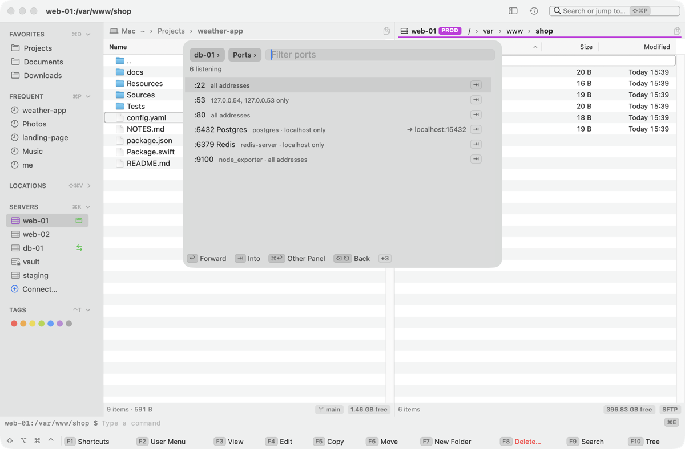

[Kermo documentation](../README.md#documentation)

# SSH tunnels

Reach ports on this Mac that lead to a saved server, or past it: a database that listens only on the server's localhost, a web admin (Grafana, RabbitMQ, Proxmox), a host behind the server. A tunnel you keep belongs to a [saved server](servers.md#save-a-server); [Forward Port…](#forward-a-port-the-server-listens-on) makes a temporary one on any server.

## Open the tunnel list

- A saved server's sidebar menu ▸ **Tunnels**.
- **Go ▸ Tunnels** lists every server's tunnels.
- ⇧⌘P: **Tunnels…** (↩ turns one on or off, ⌘E edits it, ⌘C copies its address, ⌘O opens it in the browser, ⌘S saves a temporary one, ⌘⌫ deletes it), **New Tunnel…** (on the server the panel is on, or pick one) and **Forward Port…**.

## Add a tunnel

Choose **New Tunnel…**, then fill in:

- **Forward**, written as `ssh -L` takes it. Kermo checks it as you type and shows the way it goes under the field.

  | Forward | Means |
  |---|---|
  | `5432` | This Mac's 5432 to the server's own 5432 |
  | `15432:5432` | This Mac's 15432 to the server's 5432 |
  | `15432:db.internal:5432` | This Mac's 15432 to `db.internal:5432`, a host as the server sees it |
  | `15432:[::1]:5432` | The same to the server's IPv6 localhost |

- **Name.** It defaults to the port's usual one (Postgres, MySQL, Redis, MongoDB, Grafana …).
- **URL**, optional. A web port gets one, so **Open in Browser** works (it turns the tunnel on first if it's off).

A local port that's taken is said at once, with the next free one ("Use 15433"). Kermo never changes a tunnel's port by itself: a stable port is what your database client keeps.

## Forward a port the server listens on

**Forward Port…** (⇧⌘P, **Go ▸ Tunnels**, or a server's sidebar menu, also under its **Tunnels**) asks the server what it listens on — its own `ss`, or `netstat` where there's no `ss` (BusyBox included) — on the server the panel or SSH tab is on, or one you pick, saved or not. A locked server asks for Touch ID first, and a password, if one is due, is asked next. While it looks, the picker says so; ⎋ stops it.



Each port is a row: ":5432 Postgres · postgres · localhost only", ":80 · nginx · all addresses". The program shows where the server shows it: without root, `ss` and `netstat` name only your own processes. A port that listens on one other address alone is forwarded to that address. A port a tunnel of the server already forwards says where: "→ localhost:15432".

| Key | Does |
|---|---|
| ↩ | Forwards the port by a temporary tunnel |
| ⌘O | The same, and opens it in the browser |
| ⌘C | The same, and copies its address |
| ⌘S | The same, and saves it as one of the server's tunnels (the server must be saved) |

The tunnel takes the same port on this Mac when it's free, else the next free one, and the status line says so: "Postgres: localhost:5433 → db1:5432 (5432 is taken here) · listening". It never moves afterwards. A port that a saved tunnel already goes to turns that tunnel on instead.

**Temporary tunnels** live until you turn them off, Disconnect, the lock or quitting. They're marked "temporary" in the menus and in **Tunnels…**, show `⇄` on their server's row (the row stays in the sidebar while they listen; its tooltip marks them "temporary"), and their menu has Turn Off, Open in Browser, Copy Address and, once the server is saved, **Save**, which keeps the port open and makes it a tunnel that listens at launch.

## How it works

Kermo listens on `localhost:<port>` itself, on `127.0.0.1` and `::1` as `ssh -L` does. Each connection there goes over the server's shared ssh connection (`ssh -W host:port`): one login with its panels and terminals, `ProxyJump` included.

After sleep or a network change nothing needs restarting: the next connection logs in again, unnoticed with a key or a saved password. A password dialog for a connection in the background says which tunnel it's for. Tunnels that were on listen again at launch, without connecting until a client comes.

## State

Each tunnel shows a ●:

- **green:** listening, with its open connections ("Postgres → 15432 · 3");
- **grey:** off;
- **red:** its last connection failed, or it couldn't start listening (a taken port, for example).

The reason is in the tooltip and, once per new reason, in the status line: "Nothing listens on localhost:5432 (as seen from db1)", "db1 forbids port forwarding (AllowTcpForwarding / PermitOpen)", "db1 can't resolve db.internal". It comes from ssh's own log of that connection (`/tmp/dfm-ssh-<uid>/log-<host>_<port>`, owner-only, gone with the connection).

The sidebar shows a green `⇄` on a server while its tunnels listen (`⇄ 2` for two), red when one failed. Under the mouse it opens the server's tunnels.

## Turn off and quit

- **Turning a tunnel off closes its open connections.** It asks first while there are some.
- **Disconnect** turns the server's tunnels off too. Quitting closes them and asks only about open connections.
- An edit that changes where a tunnel goes leaves the connections already open going where they went.
- A server with a tunnel on keeps its connection when its last panel closes.

## Locked servers

Turning a tunnel on asks for Touch ID unless the server was unlocked in the last 5 minutes; its connections don't ask again. Locking the screen or sleep turns these tunnels off (connections already open live on, until Disconnect or quitting), and they don't start at launch. An edit that moves a tunnel to a locked server's address turns it off too.

A production server's tunnels are purple, like the server. Turning one on doesn't ask the production question (a locked production server still asks for Touch ID): a tunnel changes nothing there by itself.

> [!WARNING]
> Kermo listens on this Mac's loopback only, never on other addresses; a port someone else has there or on every address counts as taken. But **any program or user on this Mac can connect to that port**, as with `ssh -L`, and reach what the tunnel leads to as you. Keep a tunnel to a production database off when you don't need it.

## Where tunnels are kept

With their server in `~/.config/dfilemanager/servers.json`, read at launch (temporary ones aren't kept anywhere):

```json
"tunnels": [{ "name": "Postgres", "localPort": 15432, "host": "localhost", "port": 5432, "on": true }]
```

`port` alone is enough (the same port here, to the server itself). `url` sets the page **Open in Browser** opens.
