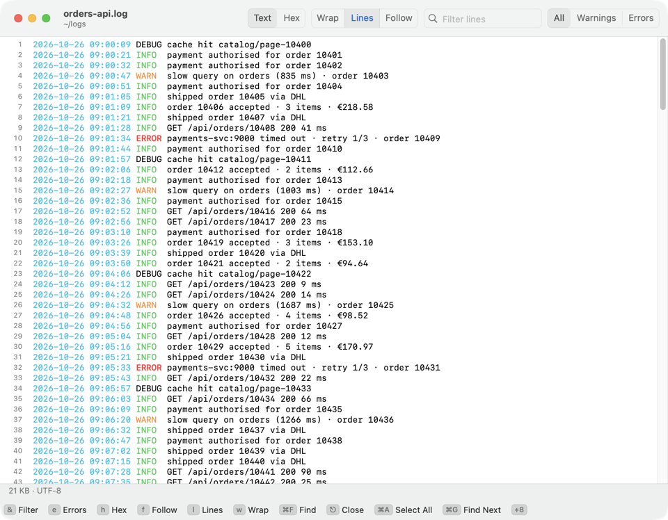

[Kermo documentation](../README.md#documentation)

# Viewer and editor

Read a file with the viewer (F3) and change it with the editor (F4); this page covers their keys and what they do with large, protected and changed files.

## Viewer

Press F3 (⌥3) on a file. Close it with ⎋, `q` or ⌘W, or with F3 or F10 itself (⌥3 works only in the panels); ⌘0 (**Window ▸ Main Window**) returns to the panels. Quick Look (⌘Y) is a separate preview.

The window's title is the file's name, with where it is under it: `~/Projects/site`, or on a server its saved name and folder, `web-01 · /var/log/nginx`. The Window menu lists it with both, `app.log — web-01 · /var/log/nginx`, so two files of one name read apart there. Below the text, a status line says what it shows: size and encoding, a filter in words (`lines with “error”, errors only`), `following`. Along the bottom, the key bar shows its keys, then the menu keys that work there; click a slot to do what its key does. The toolbar holds the same switches: **Text | Hex | Readable** (Readable only for the formats below), **Wrap**, **Lines** and **Follow** (lit while on), the **Filter lines** field (`&` goes there; ↩ applies it, ⎋ goes back to the text) and **All | Warnings | Errors**.



- `h`: switch between hex and text. A file that looks binary opens as hex; `h` shows it as text. Hex shows 1 MB: the first one, or in a huge file the one at the top of the window.
- `p`: switch between readable and raw. `.plist`, `.json`, `.strings`, `.mobileconfig` and `.entitlements` files open readable (binary plists as XML; JSON is re-indented with its keys sorted). On a file that isn't valid plist or JSON, `p` shows its text as it is; on files over 4 MB it beeps.
- `w`: wrap long lines.
- ⌘F: find in the file's text (over 4 MB: only inside the window shown, see below). ⌘G finds the next match.
- `f`: follow the file like `tail -f`. It checks twice a second and scrolls along only while you are at the end, so you can scroll up and read. It keeps about the last 8 million characters; older lines drop off the top. `h` and `p` stop it. A rotated or truncated file adds a marker line.
- `&`: keep only the lines that contain the text you enter, ignoring case. `!text` keeps the lines without it; an empty entry drops the text filter. It matches the text as shown, colors aside. Followed lines are filtered too.
- `e`: errors and warnings only (the status line says `errors and warnings`), then errors only (`errors only`), then all lines again. It goes by the same words as the colors below, works with `&` and while following, and stays on through a new `&` until you cycle it off.
- `l`: line numbers, on or off; Kermo remembers. They show for a whole file up to 4 MB; for a bigger file, the last part of a server's log or while `&` or `e` filters, the status line says why they don't.

While following, scrolling up keeps the text still as lines come in and the status line says `following, paused — End resumes`.

In a log or other plain text, lines with words like error or denied show red, and lines with warn or deprecated show amber. Terminal colors in the text (`journalctl`, `docker logs`, a log written with them) show as colors instead of escape codes, and such a line keeps its own colors instead of red or amber. Over 4 MB the window shows the colors too. A `.gz`, `.bz2`, `.xz` or `.zst` log (`.zst` needs the `zstd` program) shows unpacked, the first 32 MB; if that is over 4 MB it behaves like a file over 4 MB, however small it is on disk.

On a server panel F3 downloads the file. Its title says the file's name, with the server and folder under it, and the server's chips at the end of the title bar, PROD, ROOT or LOCKED, as the editor's does. A log over 4 MB shows only its last 4 MB; `f` follows it with `tail -F` on the server and `&` filters the whole log with `grep` there.

### Files over 4 MB

Kermo maps the file and shows a 256 KB window; scrolling past an edge slides it. ⌘F finds only inside the window. These keys reach the whole file:

- `g`: ask for a position: `50%`, `1.5G`, a byte count such as `4096`, or `end`.
- Home or ⌘↑ go to the start. End or ⌘↓ go to the end, including text added since you opened the file.
- `/`: search the whole file, ignoring case, downward from the line at the top of the view. `n` finds the next hit after the last one. The search does not wrap around; a miss beeps. It reads the file as it is, so a text that color codes split (a red `ERROR` followed by `: x`) isn't found as one.

These keys work in text mode only (`g` also in hex mode), and stop while `f` follows the file or an `&` filter is on. A filter on a huge file scans all of it and shows the first 4 MB of matching lines.

## Editor

Press F4 (⌥4) on a file. It opens text files up to 32 MB in a tab of the editor window; a binary or larger file is refused, and the message points to the viewer. F4 on a file that's already open, on this Mac or on the same server as the same user, chooses its tab: one file, one tab.

The window's title is the shown tab's file name with where it is under it, as the viewer's; the status line says the encoding and what's saved where (and, for a few seconds, a save's note); the key bar shows ⎋ and the menu keys that work there. The toolbar has **Final Newline** (lit while on, as the menu's checkmark) and, for a server's file, **Server File History…**.

- Line numbers show in the margin.
- Syntax colors cover shell, Python, JSON, YAML, INI-style files (`.ini`, `.toml`, `.cfg`, `.properties`, `.service`), `.conf`, XML (plist, HTML, SVG), Dockerfile, Makefile and C-style languages (Swift, C, C++, JavaScript, TypeScript, Go, Rust, Java and others). The file name or a `#!` line picks the language. A text over 2 MB gets no colors. The viewer colors files by name the same way.
- ⌘F opens the find bar, which also replaces. ⌘G finds the next match.
- ⌘S (**File ▸ Save**) saves. Mode, owner, extended attributes, a UTF-8 BOM and CRLF line ends stay as they were. The new text goes into a temporary file that then replaces the old one whole, and the folder is flushed to the disk too, so a power cut right after doesn't bring the old file back. A file with more than one hard link, someone else's file, or one in a folder you can't write is written into instead, so its links and owner stay. Its old text is copied first to `~/.config/dfilemanager/saves.noindex/` (yours only). The new text then goes over it and is cut to length only at the end. If the write fails on the way (a full disk), the old text is put back and the message says so; the copy goes once the file is whole. If Kermo or the Mac stops midway, the copy stays, and every launch names it until you delete it. When there's nowhere to keep the copy, the save goes ahead and the status line says so; when the disk is full, nothing is written, since the write itself could stop midway too: free some space, or use **Save As…** to another disk.

> [!WARNING]
> A file with some invalid UTF-8 bytes shows them as �, and saving writes � in their place. A file that is not UTF-8 is read and saved as Windows-1251; if it is really UTF-8, what you type will not read back correctly. The first save of either asks **Save** or **Cancel**.

### Tabs

Every document is a tab of one editor window, under its toolbar; past about 118 pt each, the tabs scroll. **＋** (and ⌘T there, ⌘N anywhere) opens a new Untitled; **⌄** (**View ▸ Tabs ▸ All Tabs…**) lists them all, filtered by name or place as you type. ⌃Tab or ⇧⌘] and ⌃⇧Tab or ⇧⌘[ go to the next and the previous tab; **Move Tab Left** and **Move Tab Right** (View ▸ Tabs and search, no keys) reorder them. The title, PROD / ROOT / LOCKED and the toolbar are the shown tab's; each tab has its own Undo, find bar, caret and scroll. The close button's dot means some tab has changes.

A mark before each name says where its text is:

- none — saved, or nothing changed;
- ● — changes that aren't in the file; they're kept as a draft (below);
- ↑ (amber) — a server's file saved here but not uploaded;
- **!** (red) — its draft couldn't be written: the status line says why, and **Save As…** keeps the text.

Two tabs of one name say where each is — `nginx.conf — web-01`, `run.sh — scripts` — and a tab's tooltip has the whole path. An italic name has no text yet: a server's file not opened since Kermo started, or a locked server's draft.

The [tools' editor](tools.md#your-own-tools) is a window of its own, as before: no tabs, no drafts; ⎋ and ⌘W close it, asking about changes.

### Untitled and Save As

⌘N (**File ▸ New Editor Document**) opens an empty **Untitled 1** (2, 3…) in the editor from any Kermo window — the panels, whatever they show, the viewer, Tools, the terminal, another editor. It's UTF-8 with LF line ends; **End with a newline** in Settings › Editor & Viewer decides its final newline. It's no file until you save it (its text is kept as a draft meanwhile): ⌘S opens the save panel in the active panel's folder on this Mac (Documents when that panel is a server's, an archive or a list). The setting that sends F4 to another app doesn't apply to it, and ⇧F4 **New File…** still makes a file first.

⇧⌘S (**File ▸ Save As…**) writes the text to a file you pick and then edits that file. The text is written first, whole: if that fails, or you cancel a question on the way (the encoding's, say), the editor stays on the file it had — a server's file stays a server's, and the next ⌘S still goes up.

- A new file gets no wider permissions than the text came from: the mode of the file on this Mac, or of the server's file (owner-only when the server didn't say); an Untitled's new file follows your umask. A file you chose to replace keeps its own mode, as a save keeps it.
- A file is replaced whole or not at all, never written into. Through a symbolic link it writes the file the link points to, and the link stays. A link to a file that isn't there, a folder, or another user's file isn't written; neither is a file that appeared there after the save panel closed.
- Save As onto a file open in another tab (or in the tools' editor) writes nothing: that tab comes forward and says why.
- A server's file saved as a file on this Mac is that file from then on: no server, no chips, no **Server File History…**. A save still going up to the server finishes, and asks in this window if it has to.

A question about a document — changed on disk, the encoding, saving as administrator, closing with changes, or an upload's — first shows its tab and brings the window out of the Dock (or back, if it was closed) and to the front.

### From any app

**New editor document from any app** in Settings › General (off at first) is a shortcut that works in every app while Kermo is running, with or without windows open: ⌃⌘E unless you record another. It brings the editor window forward, with Kermo, on a new Untitled with the text in focus. If the tab shown is an Untitled you haven't typed in yet, it just goes there, so pressing it twice gives one tab. The main window stays as it was (a Kermo that starts by it opens with its main window, as at any launch). Kermo needs no permission for it (no Accessibility, no Input Monitoring): macOS hands it that one shortcut and no other key.

- **Record…**, then press the shortcut; ⎋ cancels, ⌫ turns it off, and so does the switch — on again, it's ⌃⌘E. It needs ⌃ or ⌘. A key Kermo's menus use (⌃⌘K is Connect to Server) or macOS takes first is refused, and so is one macOS refuses (another Kermo has it); the row says why in red and the shortcut you had stays. macOS doesn't always say when another app uses the same keys: if yours does nothing, record another.
- While it's on, the shortcut is Kermo's in every app, Kermo too: **Settings › Keys** refuses it for a command, and **Reload Config** names a `keymap.json` entry that has it.
- With the shortcut on, closing every window leaves Kermo running with its icon in the Dock; watching a server puts it in the menu bar, as before. ⌘Q asks about what it would lose and writes the drafts, as with windows open.
- The Dock icon's menu has **New Editor Document** and **Show Editor** too. A click on the icon brings the main window back.
- `fm --new` in a terminal and the address `kermo://new` do the same; `kermo://show` shows the editor as it was. They take nothing else — no file, no text — so a page or an app that opens one can only open an empty document. While a question is up (Quit's, or one on the editor window) they only bring Kermo forward with it; while Kermo quits they do nothing.
- After **Quit**, the shortcut is gone with Kermo. To start Kermo by a key too, make a shortcut in the **Shortcuts** app with the action **Open URLs** and `kermo://new`, and give it a key of its own in its details (**Add Keyboard Shortcut**).

### Drafts

What you type in the editor window is kept as a draft, not saved to the file: about half a second after you stop typing (every 2 seconds at most while you go on; a big text less often, since each draft is the whole text — 10 seconds over 1 MB, 30 over 8 MB), when you switch tabs, when another app comes to the front, and right after a save. The status line says **Unsaved changes · Draft saved 14:02**. A draft never writes the file and never uploads, checks or reloads a server's file: only ⌘S does.

Drafts are kept in `~/.config/dfilemanager/editor.noindex/`, only for documents with changes and Untitled ones with text: the text and the encoding, BOM, line ends and final newline it saves with (see [what stays on this Mac](safety.md#what-stays-on-this-mac)). When Kermo starts again — after Quit, a crash or a restart — the tabs come back in their order, with the one you were on, the Untitled numbers, the caret and the scroll; the window shows if it was open.

- A file without changes is read again. One that's gone has no tab, and the status line says so.
- A file with a draft shows the draft (●). If the file changed since, a line over the text says **changed on disk since your draft** — **Compare**, **Reload**, **Save As…**; if it's gone, **Save puts it back**, with its old permissions. A draft that's what the file has (saved right before a crash) is just open.
- A server's file without changes waits as **Not connected to web-01**: a click on its tab or ↩ opens it. Nothing connects by itself.
- A server's draft shows its text (● or ↑) with no connection. ⌘S connects — Touch ID first for a [locked server](servers.md#lock-a-server), production's question again, and a change made there since asks before it's written over. A root file's draft saves as root.
- A locked server's draft shows only its name until **Unlock to see this draft**.
- A draft that can't be read is moved to `editor.noindex/damaged/` and its tab says so (**Show in Finder**); closing the tab doesn't delete it.

After a crash, the last second or two of typing may be missing: what comes back is the last draft written. If a draft can't be written (a full disk, no permission), its tab shows a red **!**, the status line says why, Kermo tries again at the next change and every 30 seconds, and the last draft written stays; closing that tab and quitting ask about it.

Only one Kermo keeps drafts at a time. Another one (a test build beside the app) shows **Drafts off** over its tabs and in the status line, and closing and quitting ask **Save** / **Don't Save** as they used to.

### Closing and changes on disk

⌘W (**Close Tab**) closes the shown tab. Without changes it just closes, an empty Untitled too. With changes it asks “Save changes to “nginx.conf” on web-01?” — **Save** (an Untitled's **Save…** opens the save panel), **Don't Save** (⌘D: discards your edits, and the draft too) or **Cancel**, one under another as macOS lays out three. For a server's file it says what Save does there besides writing: its [check](config-checks.md), the old version kept on this Mac, the production log; on a production server ↩ is Cancel and ⌘↩ saves. Typing and then undoing everything counts as no change. A tab is gone only once the editor's session without it is written; if that fails, it stays and its status line says why.

⎋ (outside the find bar, which it closes first) goes back to the panels: an unchanged tab closes, a changed one stays as a draft, and the window hides. F4, then ⎋, leaves no tab behind.

**File ▸ Close Editor Window** (⇧⌘W) and the window's close button hide the window with all its tabs, asking nothing: their drafts are written to the disk itself first, and if that fails the window stays and says why. **File ▸ Show Editor** brings it back as it was; so do F4 and ⌘N. A hidden editor window doesn't keep Kermo running: closing the main window then quits, as with no other window open — unless the [shortcut from any app](#from-any-app) is on.

Quitting writes the last drafts to the disk and asks nothing about them. It names a document only when its draft couldn't be written — **Quit Anyway** (its changes are lost), **Show Editor** or **Cancel** — or while drafts are off. Its other warnings (uploads, copies, SSH sessions, terminals) are as before.

If the file changed on disk after you opened it, ⌘S asks **Overwrite**, **Reload** (drops your edits), **Save As…** (keeps both) or **Cancel**. ↩ picks **Cancel**; ⌘↩ overwrites. When you return to the window, it reloads a changed file silently if you have no edits; otherwise it asks **Keep Mine** or **Reload**. Keep Mine loses nothing — the next ⌘S asks before writing over the file — so ↩ and ⎋ keep your text, and ⌘↩ reloads.

### Ensure Final Newline

**File ▸ Ensure Final Newline**, or **Final Newline** in the toolbar, adds a newline at the end of the text on save when it is missing. The checkmark, and the toolbar's switch, show the state for the shown tab. It starts on for config files (crontabs, dotfiles, files under `/etc`, `.conf`, `.ini`, `.yml`, `.toml` and the like) and off for other files. To set one rule for every new window, choose **End with a newline** in Settings › Editor & Viewer, or use `-bool true` (always) or `-bool false` (never):

```sh
defaults write com.dmn.dfilemanager editorFinalNewline -bool true
```

### Save as Administrator

When a save fails because the file or its folder is not yours to write, the editor asks **Save as Administrator**, with the orange ROOT strip. It shows the macOS password dialog and writes the text as root, keeping the owner, mode and hard links.

- The file is checked before the password dialog, and once more as root right before writing: if it changed while the dialog was up (another size, date or file), nothing is written and the editor asks "changed on disk" as for any change.
- The text goes to root in the command itself, so nothing else running as you can change it while macOS asks for the password. A text over about 500 KB, or one that isn't UTF-8, goes through a temporary file only you can read; root copies it and writes only if the copy is exactly your text.
- Root writes over the old text and then cuts the file to length, so a full disk never leaves it empty.
- Root refuses a file that is a symlink. One swapped in between that check and the write would still be followed (that takes a signed helper to close).

### External editor and server files

**Edit files on this Mac with** in Settings › Editor & Viewer, or `defaults write com.dmn.dfilemanager editorBundleID com.apple.TextEdit`, opens that app for F4 on a local file, for ⇧F4 (new file) and for commands such as **Edit Keymap…**. An unknown bundle ID falls back to the built-in editor. Server files always use the built-in editor.

On a server panel, F4 edits a local copy that goes up on every ⌘S; see [server files](server-files.md).
