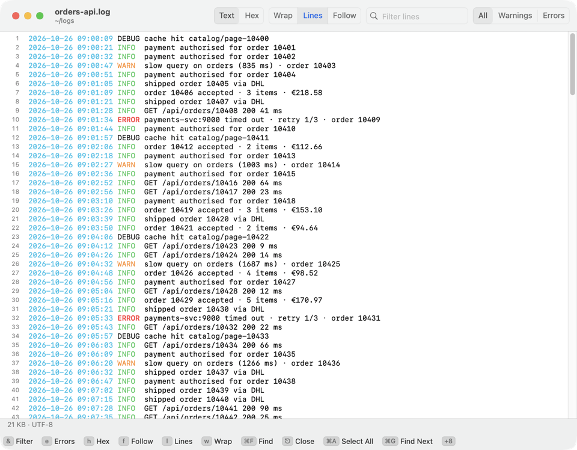

[Kermo documentation](../README.md#documentation)

# Viewer and editor

Read a file with the viewer (F3) and change it with the editor (F4); this page covers their keys and what they do with large, protected and changed files.

## Viewer

Press F3 (⌥3) on a file. Close it with ⎋, `q` or ⌘W, or with F3 or F10 itself (⌥3 works only in the panels); ⌘0 (**Window ▸ Main Window**) returns to the panels. Quick Look (⌘Y) is a separate preview.



- `h`: switch between hex and text. A file that looks binary opens as hex; `h` shows it as text. Hex shows 1 MB: the first one, or in a huge file the one at the top of the window.
- `p`: switch between readable and raw. `.plist`, `.json`, `.strings`, `.mobileconfig` and `.entitlements` files open readable (binary plists as XML; JSON is re-indented with its keys sorted). On a file that isn't valid plist or JSON, `p` shows its text as it is; on files over 4 MB it beeps.
- `w`: wrap long lines.
- ⌘F: find in the file's text (over 4 MB: only inside the window shown, see below). ⌘G finds the next match.
- `f`: follow the file like `tail -f`. It checks twice a second and scrolls along only while you are at the end, so you can scroll up and read. It keeps about the last 8 million characters; older lines drop off the top. `h` and `p` stop it. A rotated or truncated file adds a marker line.
- `&`: keep only the lines that contain the text you enter, ignoring case. `!text` keeps the lines without it; an empty entry drops the text filter. It matches the text as shown, colors aside. Followed lines are filtered too.
- `e`: errors and warnings only (the subtitle says ERRORS + WARNINGS), then errors only (ERRORS ONLY), then all lines again. It goes by the same words as the colors below, works with `&` and while following, and stays on through a new `&` until you cycle it off.
- `l`: line numbers, on or off; Kermo remembers. They show for a whole file up to 4 MB; for a bigger file, the last part of a server's log or while `&` or `e` filters, the subtitle says why they don't.

While following, scrolling up keeps the text still as lines come in and the subtitle says `paused — End resumes`.

In a log or other plain text, lines with words like error or denied show red, and lines with warn or deprecated show amber. Terminal colors in the text (`journalctl`, `docker logs`, a log written with them) show as colors instead of escape codes, and such a line keeps its own colors instead of red or amber. Over 4 MB the window shows the colors too. A `.gz`, `.bz2`, `.xz` or `.zst` log (`.zst` needs the `zstd` program) shows unpacked, the first 32 MB; if that is over 4 MB it behaves like a file over 4 MB, however small it is on disk.

On a server panel F3 downloads the file. A log over 4 MB shows only its last 4 MB; `f` follows it with `tail -F` on the server and `&` filters the whole log with `grep` there.

### Files over 4 MB

Kermo maps the file and shows a 256 KB window; scrolling past an edge slides it. ⌘F finds only inside the window. These keys reach the whole file:

- `g`: ask for a position: `50%`, `1.5G`, a byte count such as `4096`, or `end`.
- Home or ⌘↑ go to the start. End or ⌘↓ go to the end, including text added since you opened the file.
- `/`: search the whole file, ignoring case, downward from the line at the top of the view. `n` finds the next hit after the last one. The search does not wrap around; a miss beeps. It reads the file as it is, so a text that color codes split (a red `ERROR` followed by `: x`) isn't found as one.

These keys work in text mode only (`g` also in hex mode), and stop while `f` follows the file or an `&` filter is on. A filter on a huge file scans all of it and shows the first 4 MB of matching lines.

## Editor

Press F4 (⌥4) on a file. It opens text files up to 32 MB; a binary or larger file is refused, and the message points to the viewer.

- Line numbers show in the margin.
- Syntax colors cover shell, Python, JSON, YAML, INI-style files (`.ini`, `.toml`, `.cfg`, `.properties`, `.service`), `.conf`, XML (plist, HTML, SVG), Dockerfile, Makefile and C-style languages (Swift, C, C++, JavaScript, TypeScript, Go, Rust, Java and others). The file name or a `#!` line picks the language. A text over 2 MB gets no colors. The viewer colors files by name the same way.
- ⌘F opens the find bar, which also replaces. ⌘G finds the next match.
- ⌘S (**File ▸ Save**) saves. Mode, owner, extended attributes, a UTF-8 BOM and CRLF line ends stay as they were. The new text goes into a temporary file that then replaces the old one whole. A hard-linked file, or someone else's in a folder you can write, is written into instead (so its links and owner stay): over the old text, cut to length only at the end, so a full disk never leaves it empty.

> [!WARNING]
> A file with some invalid UTF-8 bytes shows them as �, and saving writes � in their place. A file that is not UTF-8 is read and saved as Windows-1251; if it is really UTF-8, what you type will not read back correctly. The first save of either asks **Save** or **Cancel**.

### Closing and changes on disk

⎋ or ⌘W closes the editor. With unsaved changes it asks **Save**, **Cancel** or **Don't Save**, which discards your edits. Typing and then undoing everything counts as no change. Quitting Kermo lists unsaved editors too.

If the file changed on disk after you opened it, ⌘S asks **Overwrite**, **Reload** (drops your edits), **Save As…** (keeps both) or **Cancel**. ↩ picks **Cancel**. When you return to the window, it reloads a changed file silently if you have no edits; otherwise it asks **Keep Mine** or **Reload**.

### Ensure Final Newline

**File ▸ Ensure Final Newline** adds a newline at the end of the text on save when it is missing. The checkmark shows the state for the current window. It starts on for config files (crontabs, dotfiles, files under `/etc`, `.conf`, `.ini`, `.yml`, `.toml` and the like) and off for other files. To set one rule for every new window, use `-bool true` (always) or `-bool false` (never):

```sh
defaults write com.dmn.dfilemanager editorFinalNewline -bool true
```

### Save as Administrator

When a save fails because the file or its folder is not yours to write, the editor asks **Save as Administrator**. It shows the macOS password dialog and writes the text as root, keeping the owner, mode and hard links.

- The file is checked before the password dialog, and once more as root right before writing: if it changed while the dialog was up (another size, date or file), nothing is written and the editor asks "changed on disk" as for any change.
- The text goes to root in the command itself, so nothing else running as you can change it while macOS asks for the password. A text over about 500 KB, or one that isn't UTF-8, goes through a temporary file only you can read; root copies it and writes only if the copy is exactly your text.
- Root writes over the old text and then cuts the file to length, so a full disk never leaves it empty.
- Root refuses a file that is a symlink. One swapped in between that check and the write would still be followed (that takes a signed helper to close).

### External editor and server files

`defaults write com.dmn.dfilemanager editorBundleID com.apple.TextEdit` opens that app for F4 on a local file, for ⇧F4 (new file) and for commands such as **Edit Keymap…**. An unknown bundle ID falls back to the built-in editor. Server files always use the built-in editor.

On a server panel, F4 edits a local copy that goes up on every ⌘S; see [server files](server-files.md).
