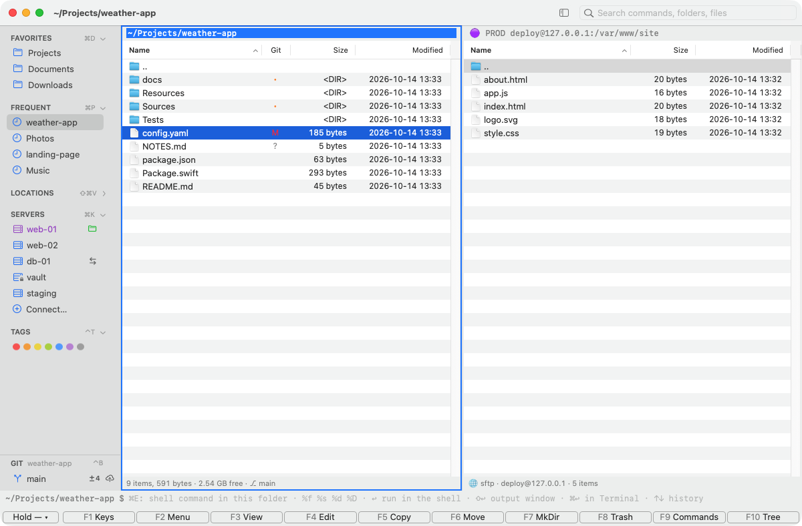
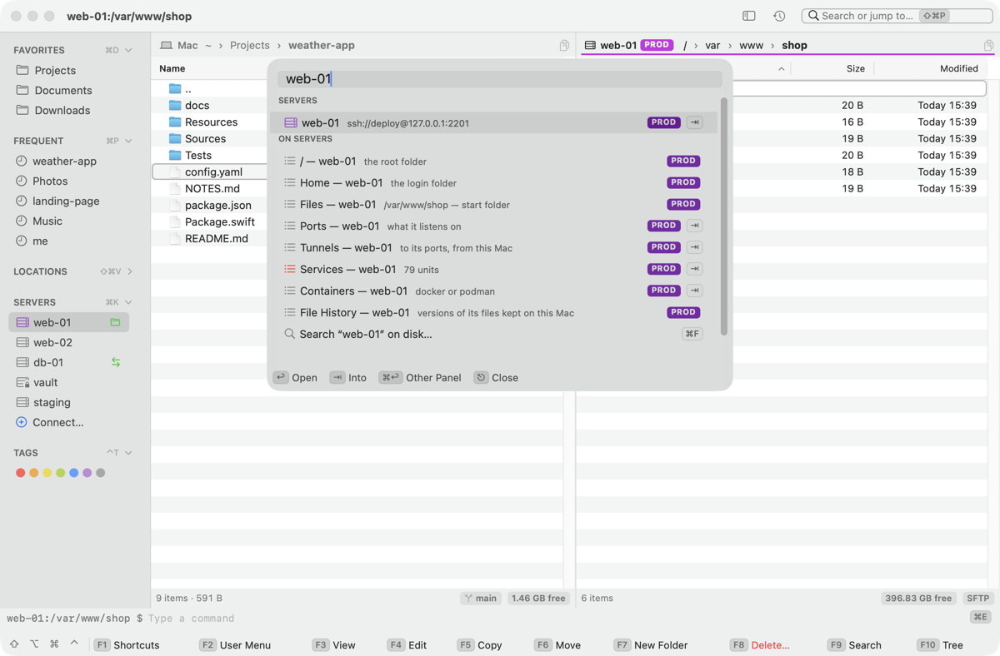
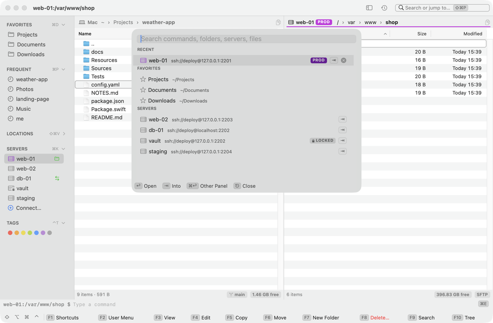

[Kermo documentation](../README.md#documentation)

# Panels, sidebar and search

How the Kermo window is laid out, and the three ways to reach anything: the key bar, the Places sidebar and search. All keys are in [Keyboard shortcuts](shortcuts.md).

## Panels and tabs

The window shows two to four panels side by side, each with its own tabs. Tab moves between panels. The active panel has a 2 pt line under its path bar in the color of where it is: the accent color on this Mac (a theme with a background has its own, cyan in Midnight Commander and Far Manager), purple on a production server, orange in a [root panel](root-panel.md), purple again when that's on a production server. Its path is in full contrast, the other panels' paths are dimmed, and their cursor is an outline (in a theme's dimmed text color). A panel can show a folder on this Mac, a [server](servers.md), an archive, a Git list, search results, or a list of what a server runs: its [services or containers](servers.md#in-a-panel), with columns, a filter and marks of its own.

The tab in front has a bold title with a line under it, in the accent color or the server's purple or orange; the other tabs' titles are grey. A server's tab has its chips before its title: PROD for a production server, ROOT for a root panel. The terminal's tabs look the same, and an SSH tab's dot is green while it's connected, grey when it isn't; a root login's tab has ROOT.

With three or four panels, F5 and F6 target the panel that was active before this one. Its path bar ends with **→ F5** in that panel's color, and the mark moves when Tab or a click makes another panel active.

### Path bar

Under the tabs, the path bar says where the panel is. First a chip for the place: **Mac**, or a server by its saved name with its chips — PROD for a production server, ROOT for a [root panel](root-panel.md), LOCKED for a server locked with Touch ID — or a box for an archive, a magnifier for search results. Then the path as crumbs: `~ › Projects › site`, on a server `/ › var › www › site`.

- **Click the server's name** at the start to see its [overview](servers.md#the-server-as-a-place), which sends nothing to the server.
- **Click a crumb** to go there; the cursor lands on the folder you came from. **⌥-click** opens it in the other panel. Drop files on a crumb to copy or move them there, as on a folder.
- In a narrow panel the middle crumbs give way to **…**; the first never does, and the folder you're in shows last.
- **Click an empty spot** of the bar (or press ⌘L) to type a path: the bar becomes a field with the plain path, all of it selected. ↩ goes there, ⇥ completes a folder's name (on a server, the server's), ⎋ or a click elsewhere brings the crumbs back. While you type, the key bar shows **↩ Go**, **⇥ Complete**, **⎋ Back to Panel**.
- **Copy** at the end copies the folder's full path: `/Users/me/Projects/site` here (not `~`), `/var/www/site` on a server. **⌥-click** on a server copies `deploy@web-01:/var/www/site`, for scp and rsync. It shows ✓ **Copied** for a second.
- A quick filter you kept with ↩ shows as a chip at the right end (click it to change the filter); with three or four panels, **→ F5** marks where F5 and F6 go.

### After a restart

Kermo comes back as you left it: each panel's tabs and the one in front, the active panel, each tab's cursor (on the same name; on the first row if that item is gone) and the dividers between the panels. Filters, Back / Forward history and marks start clean.

A server's overview, or a list of what it runs, comes back as its [overview](servers.md#the-server-as-a-place), which sends nothing.

A server tab comes back **not connected**. Its header says where it was (`web1:/etc/nginx`, with a ROOT chip for a root panel), and its middle says **Not connected**, `web1:/etc/nginx — nothing is sent until you ask`, with **↩ Connect**, **⌃⌘R As Root** and **⌘↑ This Mac** to click. Nothing is sent to any server until you ask, production and locked ones included:

- **↩** or a click on **↩ Connect** connects, as Connect does: a locked server asks for Touch ID first, and the cursor goes back to its name. A root tab connects as root; ⌃⌘R / ⌃⇧⌘R choose root or the user instead.
- ⌘↑ or ⌫ goes to the tab's folder on this Mac; the sidebar, ⌘L and the like go where you point, as on a local tab. Its crumbs go nowhere: nothing is sent until you connect.
- The F-keys, the command line and anything else that would act on the files say `Not connected — ↩ Connect to web1` and do nothing; so do copies and moves into it from the other panel.

### Status line and the panel's middle

Under the list, the status line says on the left what matters while you work: **3 marked · 12.4 MB** in bold, in the marks' color, when something is marked, else **13 items · 24 MB**; then what the list is — `filtered: 4 of 20`, `git changes: 2 of 9`, `*.log: 12 found`. On the right, chips say what just is there: the branch (`main ↑1 ↓2`), the free space (`412 GB free`), **SFTP** on a server, `zip · read-only` in an archive. A message (a copy done, an error in red) takes the left part for a few seconds.

It names no keys. While something can be stopped, **⎋ Cancel** stands beside the message; in search results **⌫ Back** goes back to the folder. Click either to do what its key does.

When there's nothing to list, the panel's middle says why and what comes next, as keys you can click:

- **Empty folder:** **F7 New Folder**, **⇧F4 New File**, **⌘V Paste** (on a server too; inside an archive, nothing: it's read-only). A folder with only hidden files says how many, with **⇧⌘. Show Hidden Files** first.
- **Not connected:** a server tab after a restart (see above).
- **Can't read this folder:** the error, and **⌘R Refresh**.
- **On its way:** after a moment, what's loading or connecting, with **⎋ Cancel** where it can be stopped.

A filter that hides every row says so in the status line, not in the middle.

SSH tabs in the terminal come back the same way: ↩ reconnects them ([Terminal](terminal.md)).

## Key bar

The bottom row shows the keys of what has the focus. Each slot is the key, then what it does in the words of its menu item (**F7 New Folder**, **F9 Search**); click it to run it, as if you pressed the key. A pressed shortcut highlights its slot.

- **Panels:** F1–F10. Hold ⇧, ⌥, ⌘ or ⌃ (or a combination such as ⇧⌘ or ⌃⌘) for a moment and it shows every shortcut that uses those modifiers.
- **The chips ⇧ ⌥ ⌘ ⌃** on the left light up while you hold them. Click one to keep its layer shown for the mouse (it's outlined then; click two for a combination such as ⇧⌘); a second click, ⎋ or running a command lets go.
- **+N** stands for the slots that don't fit the window: the cheat sheet filtered to that layer.
- **Terminal:** while the keys are in the [terminal](terminal.md) (its drawer, or over the panels with ⌃⇧O), the bar shows its keys: **⌃O Hide Terminal**, **⌃⇧O Maximize**, new and closed tabs, splits, panes, text size, ⌘1–⌘4 back to a panel. A click in a panel brings the panels' bar back with the drawer still open.
- **Viewer, editor, output windows** have a key bar of their own, the same component: see [Viewer and editor](viewer-editor.md).
- **Command line:** under the panels, at rest one quiet line: where it runs (`~/Projects/site $`, on a server `web-01:/var/www $`), **Type a command** and **⌘E** at the end (click it to go there). While it has the focus, the bar shows its keys: **↩ Run in Shell**, **⇧↩ Output Window**, **⌘↩ Run in Terminal**, **↑↓ History**, **⎋ Back to Panel**, and what `%f %s %d %D` stand for; on a [root panel](root-panel.md) one more says **Runs as deploy, not root**.
- **Quick filter:** while it has the focus, **↩ Keep**, **↓ Back to List**, **⎋ Clear**.
- **Path field** (⌘L, or a click on an empty spot of the path bar): **↩ Go**, **⇥ Complete**, **⎋ Back to Panel**.
- F1 lists the command line's, the quick filter's and the path field's keys after the menus' (it doesn't open from a text field: the field keeps F1).
- ⌥ plus a digit does what its F-key does, so those layers sum them up in one slot: `⌥1…0 = F1…F10`, `⌥⇧4 5 6 8 = ⇧F4 5 6 8`.
- On a server's panel F8 says **Delete…** in red: it deletes for good after asking, because a server has no Trash. Inside an archive F5 says **Extract**, and so does its menu item (**Extract To…**).
- F5 and F6 say where they go when it isn't plain: `Copy → web-01` when the other panel is on a server (a production server's name in purple and bold), `Copy → site` with three or four panels. With two panels on this Mac they say **Copy** and **Move**.
- The delay is 120 ms. Change it in Settings › Appearance, or with `defaults write com.dmn.dfilemanager keyBarHoldDelay 0.2`.

## Places sidebar

Show or hide it with ⌃⌘S (or the toolbar button). It has these sections:

- **Favorites:** your bookmarks (⌘D). Drag a folder in to add it, drag to reorder, right-click to remove.
- **Frequent:** the 5 folders you visit most, weighting recent visits more, that aren't Favorites.
- **Locations:** mounted volumes, then in gray the volumes of plugged-in disks that aren't mounted. See [Volumes](#volumes) below.
- **Servers:** five rows (your pinned servers plus one, if you pin more), then **Connect…** (⌘K opens an SSH shell, ⌃⌘K a file panel). Pinned servers always get a row, then the servers used last and those with an open session; saved servers and `~/.ssh/config` hosts fill any rows left. The rows keep a fixed order (pinned, saved, `~/.ssh/config` hosts, then the rest by name), not the order of use. [Server rows](servers.md#server-rows-in-the-sidebar) are explained on the servers page.
- **Tags:** Finder's 7 colors and the last 10 custom tags you set in Kermo's Tags dialog. Clicking one lists every tagged file in your home folder.
- **Git:** at the bottom, while the active panel is in a repository: its branch and what changed. See [the Git row](git.md#the-git-row-in-the-sidebar).

How to use it:

- **Click** opens a place in the active panel, **⌥-click** in the other panel, **⌘-click** in a new tab. Files dropped on a place are copied or moved there by Finder's rules.
- **⌃⇧S** moves the keyboard focus to the sidebar: ↑↓ choose a place, ↩ opens it (⌥↩ and ⌘↩ as with clicks), ⎋ goes back to the panel. Clicking the sidebar never takes the keys from the panels.
- While the keys are in the ⌃O terminal, clicking a local place runs `cd` there in the shell.
- Click a section's header to fold it (the Git section doesn't fold). The sidebar hides itself when panels get narrower than 360 pt each and returns from 400 pt, unless you hid it yourself.

### Volumes

- **Free space:** under a volume's name, a thin bar of how full it is — grey, amber from 85 % full, red from 95 % — and `350 GB free` beside it. A narrow sidebar shortens that to `350 GB`, then shows the bar alone. Widen the sidebar or hover: the tooltip says `/Volumes/USB · 110 GB used of 460 GB · 350 GB free`. Free space is counted as Finder counts it. The figures are read again every 30 seconds while Kermo is in front, after each copy, move or delete, and on mount and unmount. A network share shows the figures the system already has, and none if it has none.
- **Eject:** ⏏ on a removable or network volume's row, ⌥⌘E for the active panel's volume.
- **Mount:** a gray volume's ⊕ mounts it. Clicking its row, or ↩ on it in **Volumes…** (⇧⌘V), mounts it and opens it in the active panel.
- **Unmount:** the volume goes and its disk stays plugged in, so the row turns gray, ready to mount again. Right-click a volume for **Mount**, **Unmount** or **Eject**. **Unmount Volume** is also in ⇧⌘P, for the active panel's volume.
- **While it runs:** a spinner takes the button's place, and the row takes no second Mount, Unmount or Eject. Before Unmount or Eject, panels on the volume go to your home folder.
- **When a volume won't go:** the alert names who holds it, for example `Couldn't eject “KINGSTON”: in use by Preview, zsh`. Close the file there and try again.
- **Which volumes show unmounted:** only external and removable disks, a card in the Mac's reader among them. This Mac's own disk, the disk the Mac started from (an external one too), disk images, network shares, the EFI partition and macOS's service volumes (Preboot, Recovery, VM…) never do. On an external macOS disk the mounted system snapshot is listed, not its System volume. Unmount is offered only for volumes that can be mounted again from here. A disk image's or a share's row has Eject only.

## Search

Press ⇧⌘P (or F9, ⌥9; from the terminal ⇧⌘P), or click **Search or jump to…** in the toolbar. Search opens over the panels and finds, in groups:

- **commands** by name or synonym ("zip" finds Compress), with the menu each is in and its key on the right (F1 lists every key);
- **servers:** every saved one, the hosts of `~/.ssh/config` and the addresses you typed lately, with their PROD, ROOT and locked chips;
- **on servers:** the rows of each saved server's [overview](servers.md#the-server-as-a-place), so `serv web` finds **Services — web-01**. Nothing is sent to a server to find them;
- **folders:** Favorites, frequent folders and volumes;
- **files** in the active panel.

↑↓ choose, ↩ runs a command or opens the rest: a folder, a server as a double-click on its sidebar row does (its files), an overview's row in the active panel. ⌘↩ opens a folder, a server's files or an overview's row in the other panel. ⎋ closes. The action bar along the bottom says what the keys do on the highlighted row. The last row searches the disk (⌘F), and says so when nothing else matches.

**⇥ goes into** a row with more behind it (⇥ on its right): a server lists its [overview](servers.md#the-server-as-a-place) — nothing is sent for it — then **Services**, **Containers**, **Ports** or **Tunnels** list what they list, read as the list in a panel reads it (Touch ID first on a locked server, "Looking at services…", ⎋ stops it), and a row there lists its actions: its key on the right, why it can't now under one that can't, red what can't be undone. Chips before the field say where you are: **web-01 › Services › nginx ›**, the server's in its color. ↩ does on each row what ↩ does on it in a panel — an action asks first where it would anyway, over the search, and the line under the rows says how it went; a row's keys (⌘R, ⌘L, ⌘C) work without ⇥. ⌘↩ shows the list you're in in the other panel, as it is, without reading it again. ⌫ on an empty field or ⎋ goes back a level, to what you typed there; ⎋ at the top closes.

Empty, it lists what you choose most and lately (**Recent**: each choice counts, older ones fade), then Favorites and servers; ✕ or ⌘⌫ takes a row out of Recent.

## Pickers

The lists that ask you to choose — Search (⇧⌘P, its rows under group headers), Connect (⌃⌘K, ⌘K), Jump to Folder (⌘P), Volumes, the user menu (F2), Switch Branch (⌃B), Services, Tunnels and the rest — have one shape:

- A chip before the field says where the list is: **web-01 ›** for a server's services or ports (purple with PROD on a production server), **main ›** for a commit. The field only filters, or takes what you type.
- A line above the rows says what's known about the whole list where there's something to say (`52 units · 1 failed`, `2 of 5 changes staged`).
- A line under the rows says how the last action went, and stays until the next one; a look at a server that failed says why there.
- The **action bar** along the bottom shows what ↩ does on the highlighted row (**↩ Connect**, **↩ Status**, **↩ Turn Off**), that row's own keys (**⌘E Edit**, **⌘R Restart**), **⌃↩ Actions** where the row has a menu, **⌘↩ Other Panel** where the list can be a panel (Services, Containers), and **⎋ Close**. Click a slot to do what its key does; **+N** lists the slots that don't fit.
- An empty list says so in the middle: the list's own words (`Nothing listens on TCP there`), or **No matches** when what you typed hides every row.

## Menus

Every command is in the menu bar, in groups, with its first shortcut. Switches have ✓ while they're on.

- **Kermo:** About Kermo, Check for Updates…, Support Kermo…, Install “fm” Command, and **Configuration ▸**: the files to edit (keymap, user menu, validators, filter presets), Open Config Folder, Reload Config, Check for Updates Automatically.
- **File:** View, Edit, Quick Look, Get Info; Copy To…, Move To…, Rename…; New Folder…, New File…, **Links ▸**; Move to Trash, Put Back, Delete Permanently…; Compress…, Extract…, **Split & Combine ▸**; User Menu…, Open in Terminal, Reveal in Finder; Eject and Unmount; **As Administrator ▸**.
- **Edit:** Undo, Cut, Copy, Paste, Find… for text; Copy Path, Copy Name, Move Here for files.
- **Mark:** marking and masks; Mark Differences, Synchronize Folders…, Compare Files; **Tags ▸**.
- **View:** Sidebar, Quick View, Terminal, Maximize Terminal, Activity; **Tabs ▸** (with the terminal's splits) and **Panels ▸**; Hidden Files, Permissions & Owner, Quick Filter, Filter Presets…, Calculate Folder Sizes, **Sort By ▸**; Theme… and the terminal's text size; Refresh.
- **Go:** Back, Forward, Enclosing Folder, Open Inside, Open in Other Panel (⌘↩); Home, Computer Root, Go to Path…, Jump to Folder…, Folder Tree…, Go to Link Target, Volumes…; Bookmark This Folder; Search…, Search Files…, Command Line.
- **Server:** Connect to Server…, New SSH Session…, New Server…; Overview (⇧⌘O), Services…, Containers…, **Ports & Tunnels ▸** (its commands, then every tunnel); Reopen as Root / as User; Copy SSH Key to Server…, File History…, Run on Servers…; Disconnect, Reconnect SSH Session, Edit SSH Config…, Production Log. They work on the active panel's server, as they do from search.
- **Git:** Switch Branch…, New Branch…, Commit…; Sync, Publish Branch, Pull, Push, Fetch; Changes, Show Only Changes, Diff, Log of File, Blame, Stage, Unstage; Go to Repository Root, Copy Branch Name, Initialize Repository….
- **Window**, then **Help**: its search field finds any menu item by name (type `services` for **Server ▸ Services…**); Keyboard Shortcuts (F1), Kermo Documentation, Report an Issue….

A few commands are keys by nature and are on F1 only: Tab between panels, ↩, ⇧↑ / ⇧↓, the terminal panes' ⌥⌘ arrows and ⌃⌘ arrows, ⇧F10, ⌃↩ and ⌃⇧↩.

## Cheat sheet

F1 lists every shortcut, grouped by menu, with a filter field. It is generated from the current keymap, so your remapped keys appear in it. Over a viewer or an editor, F1 lists that window's keys and the menu keys that work there.
